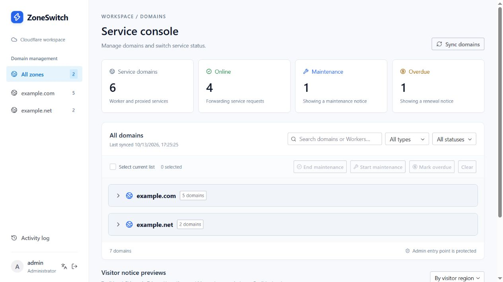
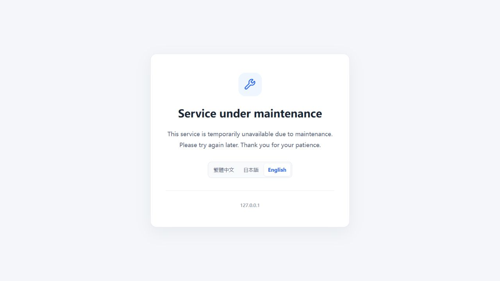
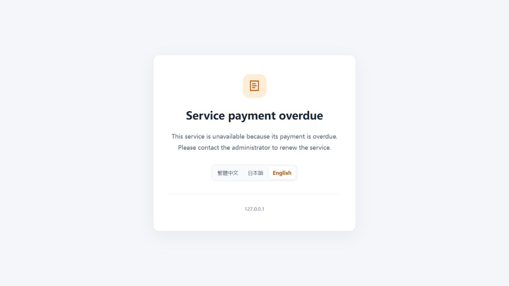

<p align="center">
  
</p>

<h1 align="center">ZoneSwitch</h1>

<p align="center">
  English ｜ <a href="README.zh-CN.md">简体中文</a>
</p>

<p align="center">
  
  
  <a href="LICENSE"></a>
</p>

<p align="center">
  <a href="docs/deployment.en.md">Deployment guide</a> ｜
  <a href="#quick-start">Quick start</a> ｜
  <a href="#usage">Usage</a> ｜
  <a href="#faq">FAQ</a>
</p>

**ZoneSwitch** is an open-source console for switching Cloudflare domains between **Online, Maintenance, and Overdue**. Manage Workers Custom Domains and server websites behind Cloudflare's proxy in one place, show notices for individual domains or batches, and restore the original website when ready.

Use it for planned maintenance, pausing hosted services, and managing multiple domains. The console switches entry points through temporary Worker Routes while preserving existing DNS and Custom Domain configuration, without changes to business code.



## Features

1. 🔄 **Three service states.** Start maintenance, show an overdue notice, or restore the original website.
2. 🌐 **Cross-zone inventory.** List authorized zones, Workers Custom Domains, and A / AAAA / CNAME records, including Worker names and DNS targets.
3. 📦 **Individual and batch controls.** Filter by zone, keyword, type, or state and select across zones. Large selections are split into batches of up to 20 domains.
4. 🖼️ **Separate visitor notices.** Maintenance and overdue pages run on dedicated static Workers, with previews in the console.
5. 🌍 **Multiple languages.** Simplified Chinese and English in the console; Traditional Chinese, Japanese, and English on visitor pages.
6. 🛡️ **Routing safeguards.** Protect admin and notice entry points, detect conflicts, and verify route ownership before updates or deletion.
7. 🔎 **Uncertain results handled explicitly.** Recheck abnormal write responses. Unresolved results stay marked as Needs verification and can be confirmed by syncing, even after a restart.
8. 📋 **Activity history.** Review the latest 100 operation batches, including the operator and each domain's result.
9. 🔐 **Admin access controls.** Password hashing, eight-hour sessions, login rate limiting, Origin / CSRF checks, and session revocation.

## Quick start

### Local demo

To try the interface and switching workflow, use demo mode. Install **Node.js 24** and npm, clone your fork or download the source, then run these commands from the project root:

```sh
npm ci
npm run demo
npm run dev
```

Open the [local console](http://127.0.0.1:8787) and sign in with:

| Username | Password |
| --- | --- |
| `admin` | `ZoneSwitch-demo-2026` |

The language button on the login page or beside your account switches between Simplified Chinese and English. The browser remembers your choice.

> [!NOTE]
> Demo mode uses example domains and simulated routes without calling the Cloudflare API. `npm run demo` creates `.dev.vars` only when the file does not exist. If you already have a configuration, use a separate project copy for the demo.

### Deploy to Cloudflare

For production use, prepare your own Cloudflare account, domains, management API token, and admin credentials. Fork this project on GitHub, then choose one deployment method:

| Method | Use case | Setup |
| --- | --- | --- |
| Cloudflare Workers Builds | Connect the repository in Cloudflare and build each Worker independently | [Workers Builds deployment](docs/deployment.en.md#3b-deploy-with-cloudflare-workers-builds) |
| GitHub Actions | Verify the project in your fork and deploy changed Workers in sequence | [GitHub Actions deployment](docs/deployment.en.md#3a-deploy-with-github-actions) |

Use `main` for development and `release` for production releases. Keep the `release` branch in your fork, select it as the Workers Builds production branch, and choose it when running GitHub Actions manually. The development branch runs checks; merge accepted changes into the release branch for deployment.

The project contains three Workers: `zone-switch` (admin console), `zone-switch-maintenance` (maintenance page), and `zone-switch-billing` (overdue page). The admin Worker uses a Durable Object for sessions, inventory, route ownership, and activity history. Normal business traffic goes directly to the original service.

Follow the [deployment guide](docs/deployment.en.md) to configure credentials, runtime settings, and the admin Custom Domain. For GitHub Actions, set `CLOUDFLARE_ACCOUNT_ID`, `CLOUDFLARE_API_TOKEN`, and `AUTO_DEPLOY=true`, then run **检查并部署 ZoneSwitch**, leaving `target=auto` for the first run.

Choose one automatic deployment method for the same set of Workers. With Workers Builds, leave GitHub's `AUTO_DEPLOY` unset or `false`. Confirm all three deployments before switching real domains.

**Updating:** Use **Sync fork → Update branch** in your fork. Your chosen platform then builds and deploys the update. See the [deployment guide](docs/deployment.en.md) for initial setup, updates, and recovery.

## Supported services

| Entry point | View | Switch state |
| --- | --- | --- |
| Workers Custom Domain | Supported | Supported |
| Cloudflare-proxied A / AAAA / CNAME record | Supported | Supported |
| Unproxied A / AAAA / CNAME record | Supported | Unsupported |

Visitor notices select a language by region: Traditional Chinese for TW / HK / MO, Japanese for JP, and English elsewhere or when region detection fails. Visitors can also switch manually between all three languages.

## Usage

1. Sign in and click **Sync domains** to load service entry points.
2. Choose a zone or filter by domain / Worker name, service type, or state.
3. Use **Start maintenance**, **Mark overdue**, or **End maintenance** on a domain, or select domains for a batch operation.
4. Review every target in the confirmation dialog. Selections can include entries outside the current filter.
5. Check the results and **Activity log**. Sync again for results marked **Needs verification**.
6. After a production change, check the business domain's home page and a deeper path.

**End maintenance** restores either maintenance or overdue mode. When restoring a specific hostname under a wildcard maintenance route managed by ZoneSwitch, it creates an exact route with no Worker script as an exception.

## Screenshots

All three screenshots on this page come from the application's local demo mode. The console above and the visitor notices below are shown in English.

### Maintenance notice



### Overdue notice



You can also use the console's **Preview** links to inspect each notice and choose a language.

## FAQ

### Does “Online” mean the website is healthy?

It describes the routing state. ZoneSwitch does not perform website health checks. Confirm that the original site responds after restoring it; Cloudflare propagation and existing browser caches can affect when a change becomes visible.

### How do I resolve “Needs verification”?

Click **Sync domains** to query the actual route. A write may have succeeded even if its response was lost. Pending markers survive restarts, and historical activity entries retain the result known at the time.

### Does the overdue state detect unpaid bills or collect payments?

The administrator selects this notice manually. ZoneSwitch does not read Cloudflare bills or collect payments.

### What do visitors and API clients receive during maintenance?

Notice pages return **HTTP 200 HTML**, including on deep paths. They do not provide a JSON / HTTP 503 maintenance response. Existing WebSocket / SSE connections, background jobs, direct origin access, and other entry points are not switched.

### Are batch operations all-or-nothing?

Each domain has its own result. A partial failure does not undo successful switches. Review the results and sync any unconfirmed state. The deployment script likewise does not automatically roll back Workers already updated.

For route conflicts, permissions, credentials, and recovery, see the [deployment guide](docs/deployment.en.md).

## Contributing

Bug reports, documentation improvements, and pull requests are welcome. Include reproduction steps and remove credentials from shared logs and screenshots.

### Local development

The console uses React, Tailwind CSS, and Radix UI. The management API runs on Cloudflare Workers, with state stored in Durable Objects. After installing dependencies, run `npm run dev` to start the development server.

For development with your account, copy `.dev.vars.example` to `.dev.vars`, fill in your own values, set `CONTROL_HOST="127.0.0.1"`, and leave `DEMO_MODE` unset. **This mode modifies real Cloudflare routes.** See the [configuration instructions](docs/deployment.en.md#local-development-with-your-account).

After the main development service has built the static assets, run `npm run dev:maintenance` and `npm run dev:billing` in separate terminals to open the [maintenance page](http://127.0.0.1:8790) and [overdue page](http://127.0.0.1:8791). Local notices start in English and support manual language switching.

On Windows, run `change-admin-password.bat` to update the local password in `.dev.vars`. Enter the same 8–32 character password twice, then restart the development service. Deployed credentials are configured separately in Cloudflare.

### Before submitting changes

```sh
npm test
npm run build:ci
npm run dry-run:all
```

Tests use simulated APIs and in-memory storage. The final command checks deployment packaging for all three Workers without uploading them. Also manually verify the affected workflow.

### Project structure

```text
src/                 Admin Worker, Cloudflare API, Durable Object state
ui/admin/            Console pages and interactions
ui/notice/           Visitor language controls
shared/              Shared types and translations
scripts/             Development, build, password, and deployment helpers
tests/               Core regression tests
docs/                Deployment guides and interface screenshots
```

## License

See the [changelog (Chinese)](CHANGELOG.md) for version history and the [release checklist (Chinese)](docs/releasing.md) for verification and acceptance steps.

ZoneSwitch is open source under the [MIT License](LICENSE).
