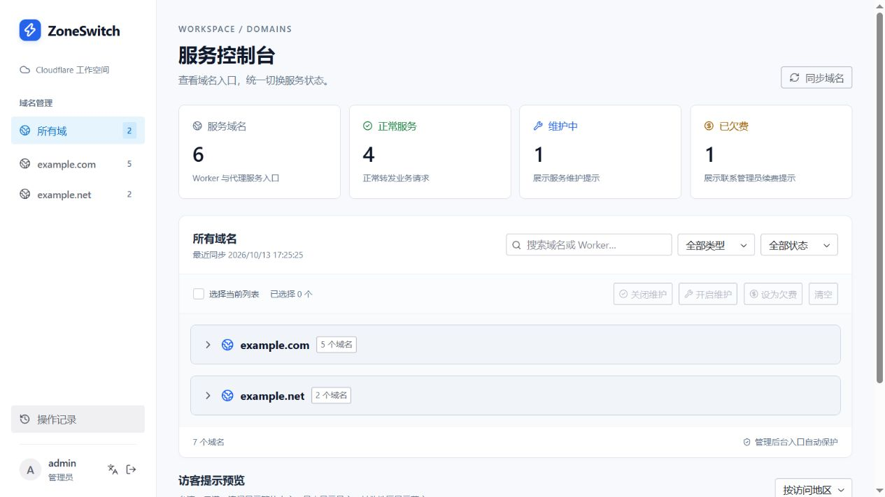
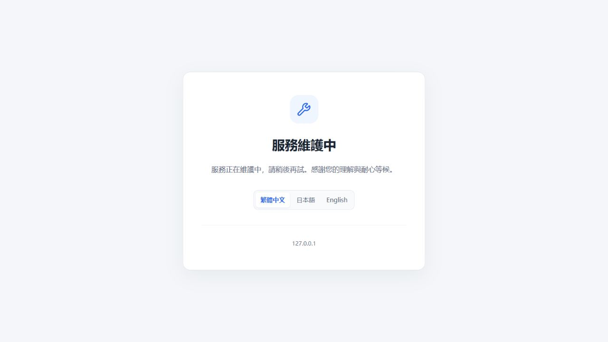
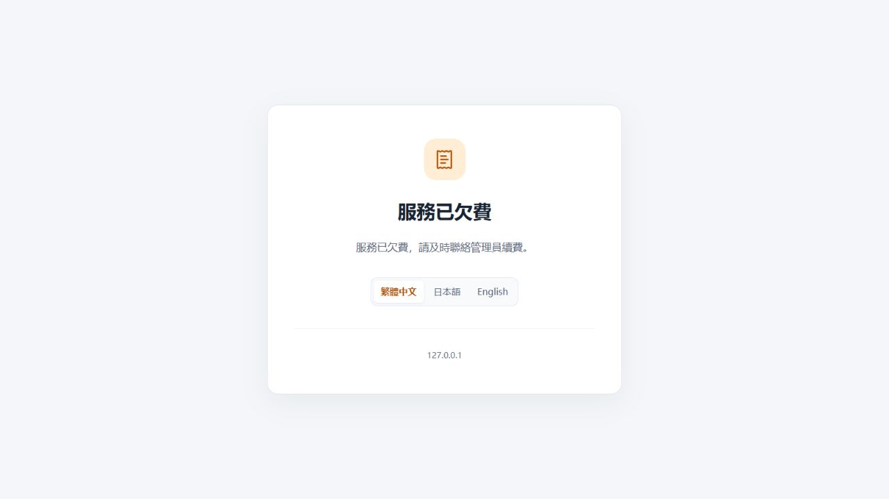

<p align="center">
  
</p>

<h1 align="center">ZoneSwitch</h1>

<p align="center">
  <a href="README.md">English</a> ｜ 简体中文
</p>

<p align="center">
  
  
  <a href="LICENSE"></a>
</p>

<p align="center">
  <a href="docs/deployment.md">部署文档</a> ｜
  <a href="#快速开始">快速开始</a> ｜
  <a href="#使用方式">使用方式</a> ｜
  <a href="#常见问题">常见问题</a>
</p>

**ZoneSwitch** 是一个开源的 Cloudflare 域名服务状态控制台，支持在**正常服务、维护中、已欠费**之间切换。无论是 Worker 自定义域名，还是通过 Cloudflare 代理的服务器网站，都可以在同一个后台中管理，单独或批量展示提示页，并在需要时恢复原网站。

适用于计划维护、暂停托管服务和多域名统一管理。后台通过临时 Worker Route 切换访问入口，保留原有 DNS 与 Custom Domain 配置，无需修改业务代码。



## 主要功能

1. 🔄 **三种服务状态。** 开启维护、设置欠费提醒，或恢复原网站。
2. 🌐 **跨域统一管理。** 汇总授权的 Zone、Worker 自定义域名及 A / AAAA / CNAME 记录，展示 Worker 名称与 DNS 目标。
3. 📦 **单个与批量操作。** 按域、关键词、类型和状态筛选，跨域选择；大批量选择自动拆分，每批最多 20 个域名。
4. 🖼️ **独立访客提示页。** 维护、欠费各有独立的静态 Worker，支持在后台预览。
5. 🌍 **多语言界面。** 后台支持简体中文和英文；访客提示支持繁体中文、日文和英文。
6. 🛡️ **路由保护。** 保护后台和提示页入口，检查冲突，修改或删除路由前核对归属。
7. 🔎 **异常结果核实。** 写入响应异常后重新查询，无法确认时标记为“待核实”，重启后仍可通过同步确认。
8. 📋 **操作记录。** 保留最近 100 批操作，查看操作人及各域名的处理结果。
9. 🔐 **后台访问控制。** 密码哈希、8 小时会话、登录限流、Origin / CSRF 校验与会话撤销。

## 快速开始

### 本地演示

想先体验界面与切换流程，可以使用演示模式。安装 **Node.js 24** 和 npm，克隆自己的 Fork 或下载源码，在项目根目录执行：

```sh
npm ci
npm run demo
npm run dev
```

打开 [本地控制台](http://127.0.0.1:8787)，使用以下演示账号登录：

| 账号 | 密码 |
| --- | --- |
| `admin` | `ZoneSwitch-demo-2026` |

登录页和后台账号旁的语言按钮可切换简体中文 / English，浏览器会记住选择。

> [!NOTE]
> 演示模式使用示例域名和模拟路由，不调用 Cloudflare API。`npm run demo` 只在 `.dev.vars` 不存在时生成配置；已有配置时请另用一份项目副本体验。

### 部署到 Cloudflare

正式使用需要自己的 Cloudflare 账号、域名、管理 API Token 和后台账号。将项目 Fork 到自己的 GitHub 仓库，再选择一种自动部署方式：

| 方式 | 适用场景 | 配置说明 |
| --- | --- | --- |
| Cloudflare Workers Builds | 在 Cloudflare 中连接仓库，分别构建三个 Worker | [Workers Builds 部署](docs/deployment.md#4a-在-cloudflare-连接-githubworkers-builds) |
| GitHub Actions | 在 Fork 中统一检查，按顺序部署内容变化的 Worker | [GitHub Actions 部署](docs/deployment.md#4b-在自己的-fork-配置-github-actions) |

`main` 用于日常开发，`release` 用于生产发布。Fork 时保留 `release` 分支；Workers Builds 的生产分支和 GitHub Actions 手动运行分支均选择 `release`。开发分支只检查，验收后的版本再合入发布分支。

项目包含三个 Worker：`zone-switch`（管理后台）、`zone-switch-maintenance`（维护页）和 `zone-switch-billing`（欠费页）。后台使用 Durable Object 保存会话、域名清单、路由归属和操作记录；正常业务流量直接访问原服务。

按[部署文档](docs/deployment.md)配置凭据、运行参数和后台 Custom Domain。GitHub Actions 需设置 `CLOUDFLARE_ACCOUNT_ID`、`CLOUDFLARE_API_TOKEN` 及 `AUTO_DEPLOY=true`，再运行“**检查并部署 ZoneSwitch**”，首次保留 `target=auto`。

同一套 Worker 选择一种自动部署方式即可。使用 Workers Builds 时，将 GitHub 的 `AUTO_DEPLOY` 留空或设为 `false`。三套部署都成功后，再使用真实域名切换功能。

**后续更新：** 在自己的 Fork 中使用 **Sync fork → Update branch**，由选定的平台自动构建部署。首次部署、更新与恢复说明见[部署文档](docs/deployment.md)。

## 支持的服务入口

| 入口 | 查看 | 切换状态 |
| --- | --- | --- |
| Worker 自定义域名 | 支持 | 支持 |
| 已开启 Cloudflare 代理的 A / AAAA / CNAME 记录 | 支持 | 支持 |
| 未开启 Cloudflare 代理的 A / AAAA / CNAME 记录 | 支持 | 不支持 |

访客提示页按地区选择语言：TW / HK / MO 使用繁体中文，JP 使用日文，其他地区或地区识别失败时使用英文。访客也可手动切换三种语言。

## 使用方式

1. 登录后台，点击“**同步域名**”获取服务入口。
2. 选择域，或按域名 / Worker 名称、服务类型、状态筛选。
3. 在域名行点击“**开启维护**”“**设为欠费**”或“**关闭维护**”；批量操作时先选中域名。
4. 在确认弹窗中核对全部目标。已选域名可能包含当前筛选结果之外的条目。
5. 查看处理结果和“**操作记录**”；遇到“**待核实**”时，再次同步确认。
6. 线上切换后，检查业务域名首页和深层路径。

“关闭维护”可恢复维护中或欠费状态。在本系统管理的通配维护路由下恢复具体主机时，会添加精确的无脚本 Route 作为例外。

## 界面预览

本页三张截图均来自应用的本地演示模式：上方为简体中文后台，下方为繁体中文访客提示页。

### 维护提示



### 欠费提示



也可以通过后台的“**预览**”链接查看提示页并选择语言。

## 常见问题

### “正常服务”是否代表网站运行正常？

它表示路由状态，项目不执行网站健康检查。恢复后需要确认原网站响应；Cloudflare 配置传播和既有浏览器缓存可能影响实际生效时间。

### “待核实”应该怎么处理？

点击“**同步域名**”查询实际路由。写入可能已成功，但响应丢失；待核实标记在重启后仍保留。历史操作记录保留当时获知的结果。

### 欠费状态会自动检测账单或收款吗？

欠费提示由管理员手动设置，不读取 Cloudflare 账单，也不处理收款。

### 维护期间，访客和 API 客户端会收到什么？

提示页返回 **HTTP 200 HTML**，深层路径也显示提示，不提供 JSON / HTTP 503 维护响应。既有 WebSocket / SSE 连接、后台任务、源站直连和其他入口不会随之切换。

### 批量操作是否会全部成功或全部回滚？

每个域名单独记录结果，部分失败不会撤销已经成功的切换。查看各域名结果，并同步核实未确认的状态。部署脚本同样不会自动回滚已更新的 Worker。

更多路由冲突、权限、密码和恢复问题，请参阅[部署文档](docs/deployment.md)。

## 参与贡献

欢迎提交问题、改进文档和发起 Pull Request。反馈问题时请附上复现步骤，并移除日志、截图中的凭据。

### 本地开发

后台采用 React、Tailwind CSS 和 Radix UI；管理 API 运行于 Cloudflare Workers，状态保存于 Durable Objects。安装依赖后，使用 `npm run dev` 启动开发服务。

使用真实账号开发时，将 `.dev.vars.example` 复制为 `.dev.vars`，填写自己的参数，设置 `CONTROL_HOST="127.0.0.1"`，不设置 `DEMO_MODE`。**此模式会修改真实 Cloudflare 路由**，配置步骤见[部署文档](docs/deployment.md)。

主开发服务完成静态资源构建后，可在两个独立终端分别运行 `npm run dev:maintenance` 和 `npm run dev:billing`，访问 [维护页](http://127.0.0.1:8790) 和 [欠费页](http://127.0.0.1:8791)。本地提示页初始显示英文，可手动切换。

Windows 用户可运行 `change-admin-password.bat` 修改本地 `.dev.vars` 中的密码：输入两次相同的 8～32 位密码，再重启开发服务。线上密码在 Cloudflare 中另行配置。

### 提交前检查

```sh
npm test
npm run build:ci
npm run dry-run:all
```

测试使用模拟 API 和内存存储；最后一条命令检查三套 Worker 的部署打包，不上传。完成检查后，还需人工验证受影响的操作流程。

### 项目结构

```text
src/                 管理 Worker、Cloudflare API、Durable Object 状态
ui/admin/            后台页面与交互
ui/notice/           访客语言控件
shared/              共享类型与翻译
scripts/             开发、构建、密码及部署脚本
tests/               核心回归测试
docs/                部署指南与界面截图
```

## 许可证

版本变化见[更新记录](CHANGELOG.md)，发布前检查和验收步骤见[发布检查清单](docs/releasing.md)。

ZoneSwitch 基于 [MIT 许可证](LICENSE) 开源。
