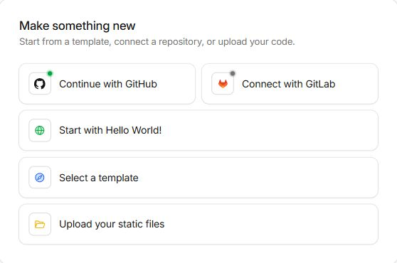
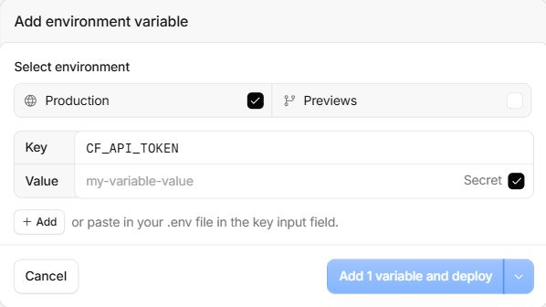
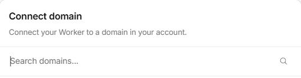

# Deploy ZoneSwitch to Cloudflare

[English](deployment.en.md) | [简体中文](deployment.md) · [Back to README](../README.md)

Use your own Cloudflare account, domains, and repository. Choose **one deployment trigger** for the same set of Workers: GitHub Actions or Cloudflare Workers Builds.

Use `main` for development and local checks. GitHub Actions checks, builds, and deployment run only for pushes to `release` or manual runs selecting `release`; pushes to `main` and pull requests do not trigger the workflow. Select `release` as the production branch for all three Workers Builds projects too. Merge your development changes into the release branch after acceptance.

Screenshots were captured on October 16, 2026 and cropped to exclude account details, avatars, repository ownership, and personal domains. Field names and `AUTO_DEPLOY=true` are unsaved examples; secret values are blank. These images show where to configure deployment, not a completed deployment. All screenshots use the English interface.

## 1. Prepare the account and management token

Your server's A / AAAA / CNAME records must be proxied by Cloudflare. Worker services must already have their business Custom Domains.

Create a management API token with these permissions, limited to the account and zones you want to manage:

| Resource | Permission                  | Purpose                          |
| -------- | --------------------------- | -------------------------------- |
| Zone     | Zone Read                   | List zones                       |
| Zone     | DNS Read                    | Read service records             |
| Zone     | Workers Routes Edit / Write | Read and modify temporary routes |
| Account  | Workers Scripts Read        | List Workers Custom Domains      |

This runtime token is separate from the deployment token that uploads Workers.

## 2. Configure the admin Worker

Create an admin Worker named `zone-switch` in Cloudflare. An initial placeholder is sufficient; deployment replaces its code.

Open **Compute → Workers & Pages → Create application**. Choose **Start with Hello World!** to create the placeholder, then name it `zone-switch`. **Continue with GitHub** is the repository-based option; use the commands in section 3B for that method.



Generate your own password hash locally:

```sh
npm run password
```

Open the admin Worker's **Settings → Runtime variables and secrets → Add variable**. Some dashboard versions label this section **Variables & Secrets**. Add the following settings:

| Name                      | Kind     | Value                                                                     |
| ------------------------- | -------- | ------------------------------------------------------------------------- |
| `CF_ACCOUNT_ID`           | Secret   | Your Cloudflare account ID                                                |
| `CONTROL_HOST`            | Secret   | Your admin hostname, e.g. `control.example.com`, without a scheme or path |
| `WORKER_NAME`             | Variable | `zone-switch`                                                             |
| `MAINTENANCE_WORKER_NAME` | Variable | `zone-switch-maintenance`                                                 |
| `BILLING_WORKER_NAME`     | Variable | `zone-switch-billing`                                                     |
| `ADMIN_USERNAME`          | Secret   | Your chosen admin username                                                |
| `CF_API_TOKEN`            | Secret   | Your management API token                                                 |
| `ADMIN_PASSWORD_HASH`     | Secret   | The output of `npm run password`                                          |

Account IDs, hostnames, and usernames are stored as Secrets here to keep personal deployment details out of the public configuration. Existing plain-text variables also work for these three settings. The API token and password hash must be Secrets.

The example below uses `CF_API_TOKEN`: select **Production**, enter the name in **Key** and your own token in **Value**, then enable **Secret**. Leave that checkbox off for the three plain-text Worker name variables. Click **Add variable and deploy** when ready; the button includes the number of variables after you enter a name. The screenshot leaves the secret value blank; add all settings in the table before using the console.



Open the admin Worker's **Domains** tab and click **Add Domain**. Follow the dashboard flow to select your managed domain and configure a **Custom Domain** matching `CONTROL_HOST`. Some dashboard versions use **Settings → Domains & Routes**. Setting the variable alone does not bind the domain. Use HTTPS for the deployed console, leave `DEMO_MODE` unset, and choose your own password.

The crop below shows only the domain search entry point; the personal domain list is excluded. Select your own managed domain and follow the prompts to configure the admin hostname, such as `control.example.com`.



The two visitor Workers do not need admin credentials. The supplied configuration creates the admin Durable Object binding and its SQLite migration.

## 3A. Deploy with GitHub Actions

1. Fork this project and enable **Actions** in your fork. If **Copy the main branch only** is selected in the fork form, clear it so the fork also includes the `release` branch.
2. In **Settings → Secrets and variables → Actions**, add repository secrets `CLOUDFLARE_ACCOUNT_ID` and `CLOUDFLARE_API_TOKEN`. Use a deployment token authorized to deploy all three Workers.
3. Add the repository variable `AUTO_DEPLOY=true`.
4. Open **Actions → 检查并部署 ZoneSwitch → Run workflow**, select `release`, and leave `target` as `auto`.
5. Confirm that all three Workers deployed, then test the console and a business domain.

For step 2, open the **Secrets** tab and click **New repository secret**. Add each deployment secret separately. The example below uses `CLOUDFLARE_API_TOKEN`; enter your own deployment token in **Secret**, then click **Add secret**. Repeat for `CLOUDFLARE_ACCOUNT_ID`. No credential value is shown in the screenshot.


For step 3, switch to **Variables → New repository variable**, set **Name** to `AUTO_DEPLOY` and **Value** to lowercase `true`, then click **Add variable**. The screenshot shows an unsaved example. Keep this variable unset or `false` when using Workers Builds.


On `release`, the workflow runs tests, type checks, builds, and three dry-runs. With `AUTO_DEPLOY=true`, it then deploys changed Workers in this order: **maintenance → overdue → admin**. The first deployment creates the two visitor Workers.

Commits on `main` do not trigger GitHub Actions; run development checks locally. Select `release` when using **Run workflow**. If another branch is selected manually, all jobs are skipped without running checks, builds, or deployment.

For later upstream updates, use **Sync fork → Update branch** on your own fork. For a forced redeployment, choose `all`, `admin`, `maintenance`, or `billing` in the workflow. Custom Worker names must match both the deployment settings and admin runtime variables.

## 3B. Deploy with Cloudflare Workers Builds

Connect each Worker to your fork's `release` branch using the repository root:

| Worker                    | Build command      | Deploy command               |
| ------------------------- | ------------------ | ---------------------------- |
| `zone-switch-maintenance` | `npm run build:ci` | `npm run deploy:maintenance` |
| `zone-switch-billing`     | `npm run build:ci` | `npm run deploy:billing`     |
| `zone-switch`             | `npm run build:ci` | `npm run deploy:ci`          |

Prepare the three named Workers, configure the admin variables above, and use the platform's deployment identity. Keep GitHub's `AUTO_DEPLOY` unset or `false` when using Workers Builds.

Complete the two visitor deployments before using the console. These builds run independently, so check all three results. Use Node.js 24; keep the included `.node-version`, which the current automation also includes in deployment fingerprints.

For detailed setup, custom names, build watch paths, upstream synchronization, and troubleshooting, see the [extended deployment guide (Chinese)](deployment.md).

## Local development with your account

Copy `.dev.vars.example` to `.dev.vars`, fill in your own values, set `CONTROL_HOST="127.0.0.1"` for the local address above, and leave `DEMO_MODE` unset. In this mode, actions use the real Cloudflare API and modify real routes.

To change the deployed password, generate another hash and update the admin Worker's `ADMIN_PASSWORD_HASH` Secret. Changing the configured username or password invalidates existing sessions.

## How it works

| Worker                    | Responsibility                                                               |
| ------------------------- | ---------------------------------------------------------------------------- |
| `zone-switch`             | Admin UI, authentication, management API, stored state, and activity history |
| `zone-switch-maintenance` | Static maintenance notice                                                    |
| `zone-switch-billing`     | Static overdue notice                                                        |

```text
Online       business domain → original Worker Custom Domain / server
Maintenance  business domain → temporary Route → maintenance page
Overdue      business domain → temporary Route → overdue page
Restore      remove owned notice Route → original service
             or add a specific bypass under wildcard maintenance
```

Normal business traffic does not pass through the admin Worker. ZoneSwitch preserves the original DNS and Custom Domain configuration. It checks stored route ownership before updating or removing a notice route.

The console uses React, Tailwind CSS, Radix UI, and Lucide. The management API runs on Cloudflare Workers, with Durable Objects storing sessions, inventory, route ownership, and logs. The two visitor Workers serve static assets without a server-side entry point.

## Languages

| Interface                | Languages / behavior                                                                   |
| ------------------------ | -------------------------------------------------------------------------------------- |
| Admin console            | Simplified Chinese and English, manually selectable and remembered in the browser      |
| Visitor notices          | Supported browser language: Traditional Chinese, Japanese, or English               |
| Manual visitor selection | Visitors can choose any of the three languages; refreshing uses the browser language again |
| Preview                  | Choose a language in the console before opening a notice                               |


A fixed inline script in the HTML head selects a supported browser language before the first paint. Traditional Chinese (zh-Hant / zh-TW / zh-HK / zh-MO), Japanese, and English are supported; unsupported preferences fall back to English. No IP-region lookup or `/cdn-cgi/trace` request is made. All localized text and buttons are present in the static HTML. The external controls script only handles manual switching. The build generates CSP hashes for the inline scripts without enabling `script-src unsafe-inline`. Keep both notice Workers static, without a `main` entry point, asset binding, or `run_worker_first=true`; serving the notices does not invoke a dynamic Worker.

## Operational notes

- **Online is a routing state, not a health check.** Confirm the original service's availability separately.
- **Visitor notices return HTML with HTTP 200**, including on deep paths. They do not provide a JSON / HTTP 503 maintenance response for API clients.
- **Only selected Web entry points are controlled.** Existing WebSocket / SSE connections, background jobs, direct origin access, and other entry points are not switched.
- **Changes are not a global transaction.** Successful domains remain changed if another domain fails; completed deployments are not automatically rolled back when a later Worker fails.
- **Recovery needs the Cloudflare API.** A failed restore is not reported as success. Configuration propagation and existing browser / Service Worker caches may delay what visitors see.
- **Needs verification means the outcome is still unknown.** Sync to confirm it. Historical logs retain the result known at the time of the operation.
- **Conflicting or externally modified routes are left for review.** Unproxied DNS entries can be listed but cannot be switched to a notice.
- **Keep secrets out of the repository.** Personal runtime configuration belongs in local ignored files or Cloudflare; deployment credentials belong in the deployment platform.
- **Keep existing Worker and Durable Object identities stable.** Do not remove a visitor Worker while its notice routes are in use. When upgrading an older version, review business routes that still point to the admin Worker; only stored exact-host legacy routes can be migrated automatically.

[English](deployment.en.md) | [简体中文](deployment.md) · [Back to README](../README.md)
