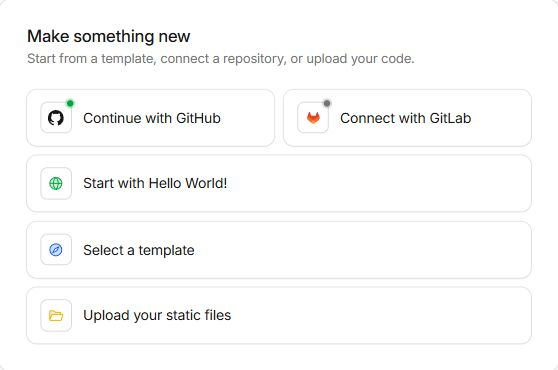
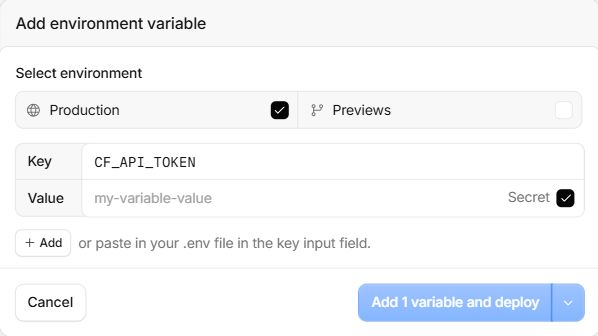
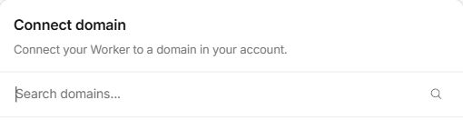
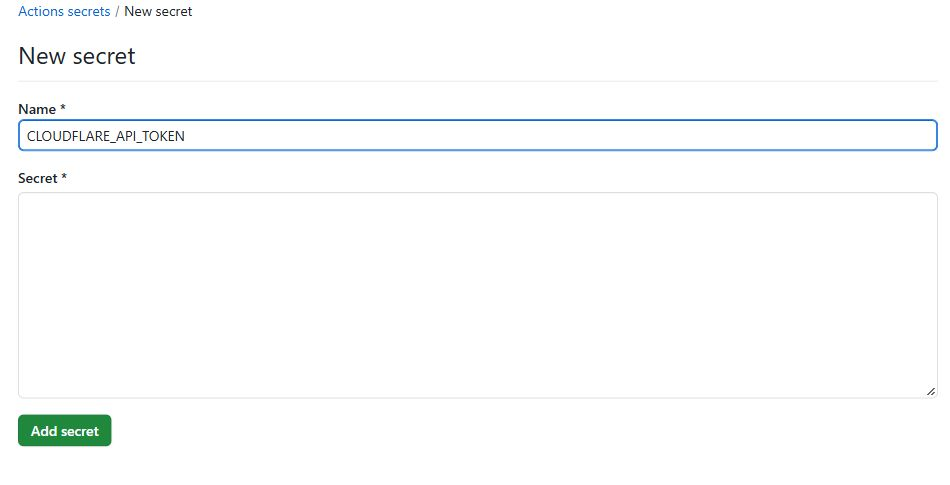
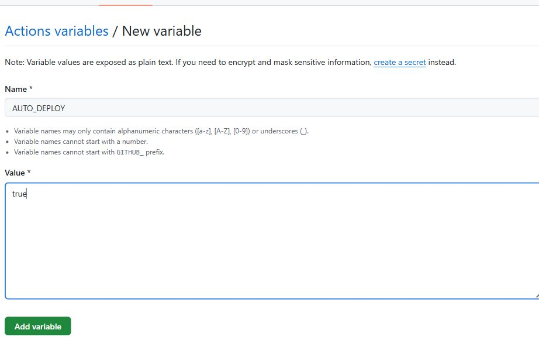

# Deploy ZoneSwitch to Cloudflare

English | [简体中文](deployment.md) · [Back to README](../README.md)

Choose [a one-sentence AI deployment request](#option-1-ask-an-ai-to-deploy) or follow the [detailed manual setup](#option-2-detailed-manual-setup). Both deploy the same project. The AI needs code execution or browser tools and authorized access to your GitHub and Cloudflare accounts or deployment credentials.

## Option 1: Ask an AI to deploy

Send this sentence to your AI coding assistant:

> Read the README and docs/deployment.en.md in https://github.com/liaobin98/ZoneSwitch and deploy its release branch to my Cloudflare account using my admin hostname and chosen automation platform, list all missing information together, enter credentials through secure inputs or platform Secrets without writing them to source files, logs, or replies, then verify all three Workers, HTTPS sign-in, and domain synchronization without switching business domain states unless separately authorized.

Provide your repository URL, Cloudflare account, admin hostname such as `control.example.com`, and choice of **GitHub Actions** or **Cloudflare Workers Builds**. Set your own admin password and generate its hash. Enter tokens through platform Secrets or a tool's secure credential input, rather than chat.

The AI should follow the steps below and report the deployed commit, each Worker's result, and the outcome of admin access and synchronization checks. A successful build or a placeholder Worker alone does not complete deployment.

## Option 2: Detailed manual setup

### 1. Prepare the repository, account, and domain

1. Fork the project into your GitHub account. Clear **Copy the main branch only** to include `release`; if you already have a fork, confirm it contains that branch.
2. Prepare a Cloudflare account with an active managed zone and choose an admin hostname, such as `control.example.com`.
3. Install **Node.js 24** and npm locally to generate the password hash. The automation platform installs dependencies and deploys the project; local Wrangler sign-in is not required.
4. Choose **GitHub Actions** or **Cloudflare Workers Builds** for this set of Workers. Enable only one deployment trigger.

Use `main` for development and local checks, and `release` for production deployment. GitHub Actions responds only to pushes to `release`; manual runs must select `release` too. Pushes to `main` and pull requests do not trigger the workflow. Set the Workers Builds production branch to `release` as well.

The project deploys three Workers with these default names:

| Worker | Configuration | Purpose |
| --- | --- | --- |
| `zone-switch` | `wrangler.jsonc` | Admin UI, authentication, API, Durable Object state, and activity history |
| `zone-switch-maintenance` | `wrangler.maintenance.jsonc` | Static maintenance notice |
| `zone-switch-billing` | `wrangler.billing.jsonc` | Static overdue notice |

The configuration creates the admin `STATE` binding and SQLite migration; no separate KV, D1, or R2 setup is needed. The two notice Workers serve static assets and need no admin credentials, Durable Object, or business Custom Domain. Normal business traffic reaches the original service directly. Temporary Worker Routes switch domains to notices while preserving business DNS and Custom Domains.

Server A / AAAA / CNAME records must be proxied by Cloudflare. Worker services must already have business Custom Domains. Unproxied DNS entries can be viewed but cannot be switched to a notice.

### 2. Create the management token and deployment identity

In Cloudflare, open **My Profile → API Tokens → Create Token → Custom token** and create a management token with:

| Resource | Permission | Purpose |
| --- | --- | --- |
| Zone | Zone Read | List authorized zones |
| Zone | DNS Read | Read A / AAAA / CNAME records |
| Zone | Workers Routes Edit / Write | Read and modify temporary routes |
| Account | Workers Scripts Read | Read Workers Custom Domains |

Select the account that will host the admin Worker and restrict zone resources to the zones you want to manage. Store this token as the admin Worker's `CF_API_TOKEN`. It does not need DNS Edit, Workers Scripts Write, or a Global API Key.

The deployment identity uploads all three Workers and is separate from the management token:

- **GitHub Actions:** create a deployment token using Cloudflare's **Edit Cloudflare Workers** template, authorize the target account and required resources, and store it in your fork's `CLOUDFLARE_API_TOKEN` Secret.
- **Workers Builds:** select an API token with deployment permissions in each Worker's build settings, using the platform's token creation flow if needed. No Cloudflare deployment credentials need to be added to GitHub.

### 3. Create the admin Worker and runtime settings

In Cloudflare **Workers & Pages → Create application**, choose **Start with Hello World!** and create a placeholder named `zone-switch`. Deployment replaces its code.



Replace `YOUR_ACCOUNT` with your GitHub account and adjust the repository name if needed, then clone your fork's `release` branch and generate a password hash:

```sh
git clone --branch release https://github.com/YOUR_ACCOUNT/ZoneSwitch.git
cd ZoneSwitch
npm ci
npm run password
```

Enter your own password of 8–32 characters. Keep the password for sign-in and use the complete generated `pbkdf2-sha256$...` hash for `ADMIN_PASSWORD_HASH`, rather than the plaintext password.

Open the admin Worker's **Settings → Runtime variables and secrets** (also labeled **Variables & Secrets**), add these production settings, and deploy them to take effect:

| Kind | Name | Value |
| --- | --- | --- |
| Secret | `CF_ACCOUNT_ID` | The selected account's 32-character Account ID |
| Secret | `CONTROL_HOST` | Your admin hostname, e.g. `control.example.com`, without a scheme, port, or path |
| Text | `WORKER_NAME` | `zone-switch` |
| Text | `MAINTENANCE_WORKER_NAME` | `zone-switch-maintenance` |
| Text | `BILLING_WORKER_NAME` | `zone-switch-billing` |
| Secret | `ADMIN_USERNAME` | Your chosen admin username |
| Secret | `ADMIN_PASSWORD_HASH` | The complete hash generated above |
| Secret | `CF_API_TOKEN` | The management token from step 2 |

The account ID, hostname, and username are also stored as Secrets to keep personal deployment details out of public configuration. The token and password hash must be Secrets. Worker names can use Secrets as well, but the deployed names and admin settings must match.



In the admin Worker's **Domains** tab or **Settings → Domains & Routes**, add a Custom Domain that exactly matches `CONTROL_HOST`. Saving the variable alone does not bind the hostname.



Leave `DEMO_MODE` unset in production. The public configuration disables `workers.dev` and preview URLs; use your HTTPS Custom Domain to access the console. Keep account IDs, personal hostnames, usernames, hashes, tokens, and business Routes out of the repository's Wrangler configuration.

### 4. Configure the automation platform

Complete either A or B, then continue to [step 5](#5-verify-deployment-and-behavior).

#### A. GitHub Actions

1. Enable the workflow **检查并部署 ZoneSwitch** in your fork's **Actions** tab.
2. Open **Settings → Secrets and variables → Actions** and add these **Repository secrets**:

| Name | Value |
| --- | --- |
| `CLOUDFLARE_ACCOUNT_ID` | The deployment account ID, matching the admin `CF_ACCOUNT_ID` |
| `CLOUDFLARE_API_TOKEN` | The deployment token from step 2, separate from the management token |



3. Under **Variables**, add a **Repository variable** named `AUTO_DEPLOY` with lowercase value `true`.



4. Default Worker names need no additional configuration. For custom names, set `WORKER_NAME`, `MAINTENANCE_WORKER_NAME`, and `BILLING_WORKER_NAME` as Variables or Secrets, and match the admin runtime settings. Secrets take precedence.
5. Open **Actions → 检查并部署 ZoneSwitch → Run workflow**, select `release`, leave `target=auto` for the first run, and start the workflow.

The workflow runs tests, type checks, a UI build, and three dry-runs, then deploys in this order: **maintenance → overdue → admin**. The first deployment can create the two notice Workers.

`auto` compares each Worker's deployment fingerprint and uploads changed content only. A Worker without a successful record is deployed. Static Worker fingerprints include final assets, configuration, the dependency lockfile, and Node version; the admin fingerprint also includes dynamic source. Shared templates, text, or dependencies may affect multiple Workers.

Documentation-only changes still run checks but skip uploads when deployment content is unchanged. Force a redeployment by selecting `admin`, `maintenance`, `billing`, or `all`; use `all` to realign after external changes to deployed content. The workflow stores deployment results using GitHub's automatic `GITHUB_TOKEN`; no additional GitHub PAT is needed. The repository must allow the workflow's `deployments: write` permission.

Confirm that **类型检查和构建** succeeds and review each Worker in **按变化部署 Worker**. Unless `AUTO_DEPLOY=true`, only checks run. A skipped deployment job does not mean code was uploaded.

#### B. Cloudflare Workers Builds

Leave GitHub's `AUTO_DEPLOY` unset or `false`. Prepare three named Workers in Cloudflare, using placeholders if needed, and connect each to your GitHub fork under **Settings → Build / Builds**:

1. Authorize Cloudflare's GitHub integration to access your repository.
2. Select `release` as the production branch and the repository root as the root directory. Use **Node.js 24** from `.node-version`.
3. Disable nonproduction branch previews (**Enable Preview Builds**).
4. Select a deployment API token for each Worker and configure its commands:

| Worker | Build command | Deploy command |
| --- | --- | --- |
| `zone-switch-maintenance` | `npm run build:ci` | `npm run deploy:maintenance` |
| `zone-switch-billing` | `npm run build:ci` | `npm run deploy:billing` |
| `zone-switch` | `npm run build:ci` | `npm run deploy:ci` |

The build platform installs dependencies before running the build command. Admin credentials belong in the runtime Secrets from step 3, not Build variables. GitHub Variables are not passed to Workers Builds.

For custom names, set the build variable `WORKER_NAME` separately in each Worker to its actual name, and use `npx wrangler deploy --config <configuration-file> --name "$WORKER_NAME"` as the Deploy command. Replace the configuration placeholder with that Worker's filename from the table. Match all three names in the admin runtime settings.

Configure each Worker's **Build watch paths** with these Include paths, one per entry, leaving Exclude paths empty:

```text
package.json
package-lock.json
.node-version
vite.config.ts
tsconfig*.json
ui/notice/*
shared/notice-*
shared/contracts.ts
src/maintenance.ts
src/notice-icons.ts
src/utils.ts
scripts/static-notices.mjs
```

Then add the Worker-specific paths:

| Worker | Additional Include paths |
| --- | --- |
| Admin | `wrangler.jsonc`, `src/*`, `shared/*`, `ui/admin/*`, `public/*`, `index.html` |
| Maintenance | `wrangler.maintenance.jsonc` |
| Overdue | `wrangler.billing.jsonc` |

See [Cloudflare Build watch paths](https://developers.cloudflare.com/workers/ci-cd/builds/build-watch-paths/) for matching rules. Paths determine whether a build starts; they do not compare output fingerprints. Shared changes can trigger multiple builds, while documentation-only changes do not match these paths. Initial connections, manual builds, and retries can still run builds.

The three builds run independently, without an ordering guarantee. Confirm both notice deployments and then the admin deployment before changing business domain states. Check each build record for its commit and deployment result.

### 5. Verify deployment and behavior

1. Confirm the actual names, deployed commits, and successful results of all three Workers. Wait for the admin hostname and HTTPS certificate to be ready.
2. Sign in with your own credentials and check the Simplified Chinese / English console switch.
3. Click **Sync domains** and check authorized zones, Worker entries, and proxied server entries. Review individual zone errors rather than relying only on a completion message.
4. On an authorized, noncritical business domain, test maintenance, overdue, and restoration. Check the temporary `<hostname>/*` Route target and confirm business DNS and Custom Domains are unchanged. Restoring a hostname under managed wildcard maintenance may add an exact route without a script as an exception.
5. Visit the home page and a deep path. Notice GET / HEAD responses return HTTP 200 HTML; unsupported methods return 405. Overdue mode is selected manually and does not detect bills or collect payments.
6. The confirmed current state's action is disabled and batches skip domains already in the target state. Individual confirmations close the dialog and report results at the top. Batches show progress and close only after full success and a successful list update; errors or uncertain results keep the dialog open. Sync and check activity records to verify uncertain outcomes.

Real visitor pages select the first supported browser preference before the first paint: all `zh` tags use Traditional Chinese, `ja` uses Japanese, and `en` uses English. Unsupported preferences are skipped; the fallback is English. Refreshing resets a manual choice. The pages make no location request, and the two notice Workers serve static assets without dynamic Worker execution.

Admin previews support an explicit language; **By visitor region** uses the administrator request's Cloudflare region: Traditional Chinese in Taiwan, Hong Kong, and Macao, Japanese in Japan, and English elsewhere. Previews use the admin API and do not replace real visitor page checks.

### 6. Routine updates and configuration

- **Update code:** select `release` in your fork and use **Sync fork → Update branch**, or merge accepted development changes into `release`. The chosen platform builds and deploys under the rules above. Upstream synchronization is a separate action, not a scheduled forced update.
- **Preserve runtime data:** public configuration retains admin dashboard variables and Secrets and does not declare business Routes. Keep the account, Worker names, `STATE` binding, `ZoneSwitchState` class, and migrations history stable. Code deployment does not clear the Durable Object.
- **Change admin credentials:** update `ADMIN_USERNAME`, or generate a new hash and update `ADMIN_PASSWORD_HASH` in Cloudflare, then deploy the settings. Existing sessions become invalid. These settings are not managed inside the console.
- **Rotate tokens:** replace `CF_API_TOKEN` in the admin runtime Secrets for management, or update the selected platform's deployment token for uploads.
- **Handle partial failures:** successful changes are not automatically rolled back if another item fails. Fix and retry failed items, then verify all results. Sync uncertain domain states without deleting Durable Object or route ownership data.

## Local development with your account

Copy `.dev.vars.example` to `.dev.vars`, fill in your own settings, set `CONTROL_HOST="127.0.0.1"`, and leave `DEMO_MODE` unset. Run `npm run dev` and open `http://127.0.0.1:8787`. This mode calls the real Cloudflare API and changes real routes. For an interface-only trial, use the [local demo](../README.md#local-demo).

Keep `.dev.vars`, personal configuration, local state, logs, and build output out of Git. Documentation screenshots should use examples or configuration crops that exclude personal details.

## Troubleshooting

| Symptom | Check |
| --- | --- |
| Actions does not run | Enable Actions in the fork and push to or manually select `release`; `main` and PRs do not trigger it |
| Checks succeed but no deployment occurs | Confirm `AUTO_DEPLOY=true`; distinguish a skipped job from an unchanged Worker |
| Workers Builds does not start | Check integration access, production branch, watch paths, and that Worker's build records |
| Deployment returns 401 / 403 | Check deployment token permissions, expiry, and account; the management token's script-read permission is insufficient for uploads |
| Admin returns 404 or sign-in fails | Check the HTTPS Custom Domain, `CONTROL_HOST`, full password hash, and deployed runtime settings; wait out login rate limits |
| Sign-in works but synchronization fails | Check the management token's four permissions, account and zone scope, and specific inventory errors |
| Notice language differs from the browser UI | Check preferred website language order: `en-US, zh-CN` selects English; `zh-CN, en-US` selects Traditional Chinese |
| Original content remains after switching | Check the business Route target, Cloudflare configuration propagation, and browser / Service Worker caches |
| Route conflict or Needs verification | Inspect actual Routes and ownership, resolve conflicts, then sync; do not overwrite routes owned by other systems |

## References

- [Project workflow](../.github/workflows/deploy.yml) · [Deployment script](../scripts/deploy.mjs)
- [Cloudflare: GitHub Actions deployment](https://developers.cloudflare.com/workers/ci-cd/external-cicd/github-actions/)
- [Cloudflare: Workers Builds configuration](https://developers.cloudflare.com/workers/ci-cd/builds/configuration/)
- [Cloudflare: Secrets](https://developers.cloudflare.com/workers/configuration/secrets/)
