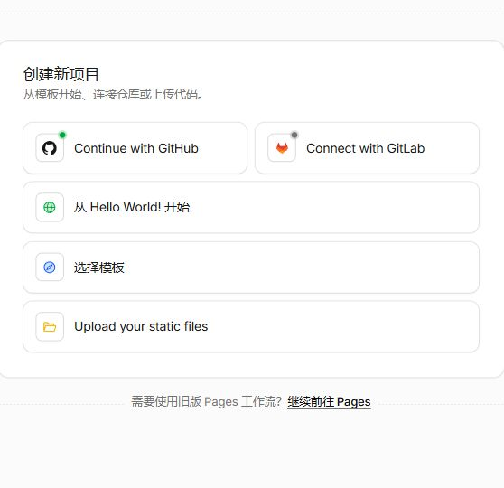
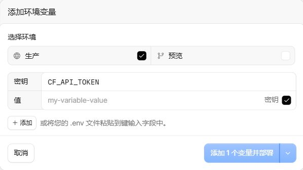
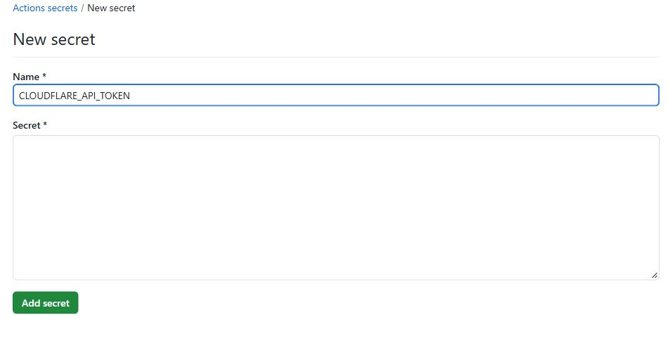
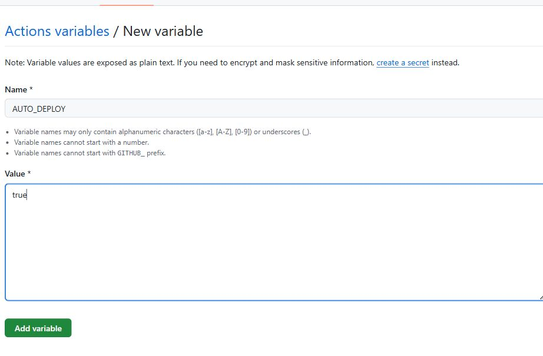

# Fork 后自动部署到 Cloudflare

[English](deployment.en.md) | [简体中文](deployment.md) · [返回项目介绍](../README.zh-CN.md)

本指南按 **Fork 到自己的 GitHub 仓库 → 配置 Cloudflare 后台 → 连接自动部署 → 同步上游更新** 编写。源码保持公开，每个人的 Worker 部署到自己的 Cloudflare 账号。

两种方式都属于自动部署，选择一种管理同一套 Worker：

| 方式                        | 操作位置                                    | 构建与部署                             |
| ------------------------- | --------------------------------------- | --------------------------------- |
| Cloudflare Workers Builds | Cloudflare 连接自己的 GitHub Fork 和分支        | 三个 Worker 分别自动构建部署                |
| GitHub Actions            | 自己的 Fork 配置 Actions Secrets 和 Variables | 比较每个 Worker 的部署内容，仅顺序更新变化的 Worker |

分支约定：`main` 用于开发和本地检查；GitHub Actions 的检查、构建与部署仅在推送 `release` 或手动选择 `release` 时运行，`main` 推送和 PR 不触发工作流。三个 Workers Builds 项目也统一选择 `release`。自己的开发修改先验收，再合入发布分支。

使用 Workers Builds 按第 4A 节操作，跳过第 4B、5 节；使用 GitHub Actions 按第 4B、5 节操作。后台账号、管理 Token 和后台域名均在 Cloudflare 面板配置。默认名称无需修改公开 Wrangler 配置，也无需创建本地个人部署配置或 `.dev.vars`。

仓库提供三份公共配置：`wrangler.jsonc`（后台）、`wrangler.maintenance.jsonc`（维护页）、`wrangler.billing.jsonc`（欠费页）。配置不含个人 Account ID、域名、账号、Token、密码或业务 Routes；个人参数在部署平台配置。

本文界面截图采集于 2026-10-16，已裁去账号、头像、仓库归属和个人域名，仅展示相关配置区域。截图中的字段名与 `AUTO_DEPLOY=true` 为未保存的示例输入，密钥值留空；截图用于定位入口，不表示已完成部署。Cloudflare 截图为中文界面，GitHub 截图为英文界面。

## 1. Fork 到自己的仓库

1. 打开本项目的上游 GitHub 仓库，点击右上角 **Fork**。
2. Owner 选择自己的账号，保留仓库名或使用自己的名称。若界面勾选了 **Copy the main branch only**，取消此选项，确保同时保留 `release` 发布分支，再点击 **Create fork**。
3. 后续操作都在 **自己的 Fork** 中进行，不在上游仓库添加凭据。
4. 如果选择 GitHub Actions，进入 Fork 的 **Actions** 页面并启用工作流，应能看到“检查并部署 ZoneSwitch”。Workers Builds 不要求启用 GitHub Actions。

Fork 不会复制上游 Secrets，也不会自动连接 Cloudflare。先完成下面的账号参数和所选部署方式的配置，再执行第一次部署。

## 2. 准备 Cloudflare 账号、域名和 Token

准备一个 Cloudflare 账号、托管在该账号下的域，以及自己的后台域名，例如 `control.example.com`。服务器的 A / AAAA / CNAME 入口需开启 Cloudflare 代理（橙云）；Worker 服务需已绑定自己的业务 Custom Domain。

自动构建平台会安装依赖并运行配置的构建命令。首次配置只需要本地生成一次密码哈希，步骤见下一节；无需在本地执行部署或 Wrangler 登录。

| Worker                    | 配置                           | 用途                    |
| ------------------------- | ---------------------------- | --------------------- |
| `zone-switch`             | `wrangler.jsonc`             | 登录、管理 API、DO 状态与日志    |
| `zone-switch-maintenance` | `wrangler.maintenance.jsonc` | 静态维护提示，HTML HTTP 200 |
| `zone-switch-billing`     | `wrangler.billing.jsonc`     | 静态欠费提示，HTML HTTP 200 |

正常业务不经过管理 Worker，也不查询 DO。开启提示由后台添加临时 Route，恢复后核验并删除，保留原业务 DNS 和 Custom Domain。两个静态配置保持无 `main`、无 DO、`assets.run_worker_first=false`；后台的 `run_worker_first=true` 用于鉴权，不能照搬静态配置。DO 由后台的 `STATE` 绑定及 `v1` SQLite 迁移创建，不需要另外创建 KV、D1 或 R2。

访客页在 head 中用固定内联脚本同步读取浏览器语言，首次绘制前选好繁体中文、日文或英文；未知语言回退英文。不会请求 `/cdn-cgi/trace`，不按 IP 地区定位，也不会在加载后自动替换语言。语言按钮与文案已在静态 HTML 中，外部控件脚本只负责手动切换。构建时为固定内联脚本生成 CSP 哈希，不启用 `script-src unsafe-inline`。两个提示 Worker 保持纯静态，不配置 `main`、资产绑定或 `run_worker_first=true`，不增加动态 Worker 请求。

### 创建两种 API Token

| 身份             | 存放位置                                                                           | 用途               |
| -------------- | ------------------------------------------------------------------------------ | ---------------- |
| 部署身份           | Workers Builds 的 API token 设置，或 GitHub Actions 的 `CLOUDFLARE_API_TOKEN` Secret | 上传和更新 Worker     |
| `CF_API_TOKEN` | 管理 Worker 的 Secret                                                             | 同步域名和切换临时 Routes |

Workers Builds 在 Cloudflare 选择部署 API Token，可使用平台自动创建的 Token；无需在 GitHub 配置部署 Secrets。GitHub Actions 使用 **Edit Cloudflare Workers** 模板创建部署 Token，并存入自己的 GitHub Secrets，要求见 [官方 CI 指引](https://developers.cloudflare.com/workers/ci-cd/external-cicd/github-actions/)。后台管理 Token 与部署身份分开，使用以下权限：

| 资源      | 权限                          | 用途                       |
| ------- | --------------------------- | ------------------------ |
| Zone    | Zone Read                   | 列出授权的域                   |
| Zone    | DNS Read                    | 读取 A / AAAA / CNAME      |
| Zone    | Workers Routes Edit / Write | 查询和修改临时 Routes           |
| Account | Workers Scripts Read        | 读取 Worker Custom Domains |

账号资源覆盖 `CF_ACCOUNT_ID`，Zone 资源只授权需要管理的域。后台不需要 DNS Edit、Workers Scripts Write 或 Global API Key；面板 Edit / Write 的文字可能不同，以 Workers Routes 写权限为准。

## 3. 配置 Cloudflare 管理 Worker

默认名称为 `zone-switch`、`zone-switch-maintenance`、`zone-switch-billing`。首次部署先在 Cloudflare **Workers & Pages** 创建同名管理 Worker，使用占位代码即可，用来提前保存下面的参数和 Secrets，工作流随后替换为项目代码。两个提示 Worker 可由首次 Wrangler 部署创建；已有实例继续使用原名称、原账号及 DO，不重新创建数据。

进入 **计算 → Workers 和 Pages → 创建应用程序**，可看到下面的方法选择界面。创建占位 Worker 时选择“**从 Hello World! 开始**”，名称填写 `zone-switch`；如果希望直接从 GitHub 创建项目，使用 **Continue with GitHub**，并按第 4A 节配置对应的构建和部署命令。



### 生成后台密码哈希

安装 Node.js 24（版本见仓库 `.node-version`）。将自己的 Fork 克隆到本地，或在自己的 Fork 页面通过 **Code → Download ZIP** 下载并解压。在包含 `package.json` 的项目根目录执行，PowerShell 示例：

```powershell
npm ci
npm run password
```

输入自己设置的 8～32 位密码，输入不显示。将输出的完整 `pbkdf2-sha256$...` 哈希用于下一步 Secret，保存自己输入的密码用于登录；不要将明文密码填入哈希配置。这一步只生成哈希，不连接或部署到 Cloudflare。

### 填写运行时参数和 Secrets

进入管理 Worker 的 **设置（Settings）→ 运行时变量和密钥（Runtime variables and secrets）→ 添加变量**。部分面板版本将此区域标为 **Variables & Secrets**。按下表添加：

| 类型     | 名称                        | 内容                                              |
| ------ | ------------------------- | ----------------------------------------------- |
| Secret | `CF_ACCOUNT_ID`           | 当前 Cloudflare 账号的 32 位 Account ID               |
| Secret | `CONTROL_HOST`            | 自己的后台域名，如 `control.example.com`，不带协议、端口、路径或末尾斜杠 |
| Text   | `WORKER_NAME`             | 管理 Worker 名称，默认 `zone-switch`                   |
| Text   | `MAINTENANCE_WORKER_NAME` | 维护 Worker 名称，默认 `zone-switch-maintenance`       |
| Text   | `BILLING_WORKER_NAME`     | 欠费 Worker 名称，默认 `zone-switch-billing`           |
| Secret | `ADMIN_USERNAME`          | 自己的登录账号                                         |
| Secret | `CF_API_TOKEN`            | 管理业务域名的 Token，权限见 README                        |
| Secret | `ADMIN_PASSWORD_HASH`     | 本地 `npm run password` 生成的完整哈希                   |

账号 ID、域名、用户名本身不是认证凭据，这里也用 Secret 保存，避免把个人部署资料写入公开仓库；已有实例使用 Text 也兼容。Token 和密码哈希必须使用 Secret。Worker 名称可用公开默认值；如果名称也不希望公开，可在 Cloudflare 改用 Secret，GitHub 部署侧则将三个名称设为同名 Repository secrets。

下图以 `CF_API_TOKEN` 为例：选择“**生产**”环境，输入变量名称，在“值”中填自己的 Token，并勾选右侧“**密钥**”。Text 类型不勾选“密钥”。截图的值字段为空；填写完自己的配置后，点击“**添加变量并部署**”使其生效。若分批添加，后续仍需补齐表中全部参数。



在后台 Worker 的“**域（Domains）**”标签点击“**添加域名（Add domain）**”，按面板流程选择自己托管的域并配置与 `CONTROL_HOST` 一致的 Custom Domain。部分面板版本的入口为 **Settings → Domains & Routes**。两个提示 Worker 不配置后台凭据、DO、业务 Custom Domain 或业务 Routes；后台会在开启维护时创建临时 Routes。域名绑定仍需在面板添加，单独保存 `CONTROL_HOST` 不会自动创建域名绑定。

下面仅截取“**连接域名**”弹窗的搜索入口，域名列表已排除。选择自己账号下的域后，继续按面板提示配置实际后台主机名，例如 `control.example.com`。


保存并部署面板配置，生产不设置 `DEMO_MODE`。等待后台域名和证书就绪后使用 HTTPS 访问。配置关闭 `workers.dev` 和预览 URL，不能用它们代替正式后台域名。

先完整配置上表参数和 Secrets，再运行工作流。公共配置不声明 `secrets.required`，避免 Wrangler 本地开发过滤 `.dev.vars` 中的其他参数；上传成功不代表运行参数完整。后台缺少管理域名或有效密码配置时不会开放正常访问，缺少管理 Token 时不能同步和切换真实域名。面板新增或修改 Secret 后点击部署才生效，见 [Cloudflare Secrets 指引](https://developers.cloudflare.com/workers/configuration/secrets/)。当前没有配置 Token 或修改密码的后台设置页，这些参数在 Cloudflare 面板管理。

部署身份和后台 `CF_API_TOKEN` 用途不同，分别配置。密码及后台业务管理 Token 不需要进入 GitHub。

## 4A. 在 Cloudflare 连接 GitHub：Workers Builds

这就是“在 Cloudflare 选择 GitHub 仓库和分支，然后自动部署”的方式。先完成第 3 节的后台参数配置，在自己的 Fork 中让 `AUTO_DEPLOY` 留空或设为 `false`，避免 GitHub Actions 也部署。

### 连接三个 Worker

在 Cloudflare **Workers & Pages** 准备以下三个同名 Worker，可先创建占位实例；已有实例直接使用。分别进入各 Worker 的 **Settings → Build / Builds**，连接 Git 仓库：

1. 授权 Cloudflare 的 GitHub 集成访问自己的 Fork。
2. 选择自己的 GitHub 账号和 Fork 仓库，生产分支选择 `release`。
3. 根目录设为仓库根目录，不要填 `src`、`ui` 或 `dist`。
4. 按下表填写构建和部署命令，保存设置。

| Worker                    | Build command      | Deploy command               |
| ------------------------- | ------------------ | ---------------------------- |
| `zone-switch-maintenance` | `npm run build:ci` | `npm run deploy:maintenance` |
| `zone-switch-billing`     | `npm run build:ci` | `npm run deploy:billing`     |
| `zone-switch`             | `npm run build:ci` | `npm run deploy:ci`          |

三套连接使用同一个 Fork、同一个 `release` 分支，各自命令部署自己的配置。欠费和维护 Worker 必须显式指定各自部署命令，默认 `npx wrangler deploy` 只读取后台的 `wrangler.jsonc`。Node.js 版本使用 `.node-version` 的 24；如覆盖 `NODE_VERSION`，也设为 24。关闭非生产分支自动构建或预览，只让选定生产分支发布。

默认 Worker 名称可直接使用。自定义名称时，在对应 Workers Builds 的构建变量中设置 `WORKER_NAME`，并将 Deploy command 改为 `npx wrangler deploy --config wrangler.jsonc --name "$WORKER_NAME"`（后台）、`npx wrangler deploy --config wrangler.maintenance.jsonc --name "$WORKER_NAME"`（维护）或 `npx wrangler deploy --config wrangler.billing.jsonc --name "$WORKER_NAME"`（欠费）。构建变量填各 Worker 自己的真实名称，Cloudflare 连接的 Worker 与 `--name` 必须一致；后台运行时的三个名称也要同步设置。无需将自定义名称提交到源码。保留 DO 绑定和迁移，不随意改已有后台名称。GitHub Variables 不会传给 Workers Builds。

在 **Settings → Build → Branch control** 关闭 **Enable Preview Builds**，避免非生产分支和 PR 触发预览部署。生产分支保留 `release`。

在构建配置中选择 Cloudflare 的部署 API Token。后台的 `CF_API_TOKEN` 和 `ADMIN_PASSWORD_HASH` 仍填 **Variables & Secrets**，不是 Build variables：构建变量与运行时变量分开。两个提示 Worker 不需要后台凭据。

### 首次部署与更新

先部署维护页和欠费页并确认成功，再部署后台，之后按第 6 节验收。连接仓库可能立即触发构建；在三套部署都成功前不要操作维护开关。

以后自己的 Fork `release` 有新提交，只有命中下方监听路径的 Worker 才触发构建。上游更新仍需先 Sync fork，不会直接更新你的仓库。到 Cloudflare 的构建记录查看相关 Worker 的结果及提交版本。

### 按 Worker 设置 Build watch paths

在各 Worker 的 **Settings → Build → Build watch paths** 设置 Include paths。每条路径单独添加，Exclude paths 留空。以下 `*` 匹配目录下的路径，规则按仓库根目录计算，见 [Cloudflare 官方说明](https://developers.cloudflare.com/workers/ci-cd/builds/build-watch-paths/)。

三套都添加：

```text
package.json
package-lock.json
.node-version
vite.config.ts
tsconfig*.json
ui/notice/*
shared/notice-*
shared/contracts.ts
src/maintenance.ts
src/notice-icons.ts
src/utils.ts
scripts/static-notices.mjs
```

然后分别追加：

| Worker | 额外 Include paths                                                         |
| ------ | ------------------------------------------------------------------------ |
| 后台     | `wrangler.jsonc`、`src/*`、`shared/*`、`ui/admin/*`、`public/*`、`index.html` |
| 维护页    | `wrangler.maintenance.jsonc`                    |
| 欠费页    | `wrangler.billing.jsonc`                            |

这样后台页面或管理接口修改只触发后台；欠费配置只触发欠费 Worker。共享模板、三语言文案、访客控件或依赖修改可能同时触发多套，这是它们真实共用的代码。构建命令会验证和生成全部产物，但部署命令只上传自己的 Worker。只改文档不触发 Workers Builds；首次连接、手动重试及平台特殊推送规则可能仍构建。

三个构建互不等待，不提供 GitHub Actions 的顺序部署保证。一套失败时，其他两套仍可能成功，需要修复并重试失败的构建。配置方式见 [Workers Builds 官方说明](https://developers.cloudflare.com/workers/ci-cd/builds/configuration/)。

## 4B. 在自己的 Fork 配置 GitHub Actions

打开 **自己的 Fork 仓库**，进入 **Settings → Secrets and variables → Actions**。

**Repository secrets**：

| 名称                      | 内容                           |
| ----------------------- | ---------------------------- |
| `CLOUDFLARE_ACCOUNT_ID` | 与后台 `CF_ACCOUNT_ID` 相同的账号 ID |
| `CLOUDFLARE_API_TOKEN`  | 部署用 Cloudflare API Token     |

部署 Token 可从 Cloudflare **Edit Cloudflare Workers** 模板创建，限制在自己的目标账号和相关域。它需要部署三个 Worker，不能使用只允许读取脚本的后台管理 Token。具体权限以官方模板和实际使用的资源为准，不将 Token 写进工作流或配置文件。

在 **Secrets** 标签点击 **New repository secret**，分别新增上表两个名称。下图以 `CLOUDFLARE_API_TOKEN` 为例，**Secret** 填自己生成的部署 Token，再点击 **Add secret**；`CLOUDFLARE_ACCOUNT_ID` 单独新增一条。截图没有填写任何密钥值。



**Repository variables**：

| 名称                        | 是否必填 | 内容                               |
| ------------------------- | ---- | -------------------------------- |
| `AUTO_DEPLOY`             | 是    | `true` 启用自动部署；删除或改为 `false` 后仅检查 |
| `WORKER_NAME`             | 否    | 自定义后台 Worker 名称，默认 `zone-switch` |
| `MAINTENANCE_WORKER_NAME` | 否    | 默认是后台名称加 `-maintenance`          |
| `BILLING_WORKER_NAME`     | 否    | 默认是后台名称加 `-billing`              |

切换到 **Variables** 标签，点击 **New repository variable**，将 **Name** 设为 `AUTO_DEPLOY`、**Value** 设为小写 `true`，然后点击 **Add variable**。下图为保存前的示例；选择 Workers Builds 时不要启用此变量。



三个名称必须不同，并与 Cloudflare 后台运行时变量及已有 Worker 名称一致。设置 GitHub Variables 只改变部署目标，不自动修改后台运行时变量。使用默认名称无需填写这三个可选变量；改名应同时改两处，不随意重命名已有 DO 后台。


如果自定义名称不希望公开，改填同名 Repository secrets；工作流优先读取 Secrets，再读取 Variables。自动部署使用 GitHub 自动提供的 `GITHUB_TOKEN` 保存每个 Worker 的成功部署摘要，只有部署 job 拥有 `deployments: write` 权限；不需要额外添加 GitHub PAT。部署记录仅保存内容摘要和提交版本，不保存 Cloudflare 凭据、域名、账号或密码；自定义 Worker 名称可能出现在部署记录与日志中，Secrets 不会让实际公开访问的服务名称变为私密。

工作流默认生产分支 `release`。如果改用其他分支，需要一起修改工作流的触发分支、部署条件和最新提交检查中的 `refs/heads/release`。

`main` 上的提交不触发 GitHub Actions，开发检查在本地执行。使用 **Run workflow** 时选择 `release`；手动选择其他分支时，所有任务均跳过，不执行检查、构建或部署。

## 5. 执行第一次 GitHub Actions 部署

首次配置完成后，在自己的 Fork 进入 **Actions → 检查并部署 ZoneSwitch → Run workflow**，选择 `release`，`target` 保持 `auto`，点击运行。第一次没有成功部署记录，将依次部署三套 Worker。

```text
自己的 Fork release
  → npm ci
  → 回归测试、类型检查、构建
  → 三套 Wrangler dry-run
  → 保存同一提交的构建产物
  → 分别与各 Worker 最近的成功部署内容比较
  → 按维护页 → 欠费页 → 后台的顺序，仅更新变化的 Worker
```

工作流文件为 [`.github/workflows/deploy.yml`](../.github/workflows/deploy.yml)，部署脚本为 [`scripts/deploy.mjs`](../scripts/deploy.mjs)。之后每次推送或合并到自己的 `release` 会自动检查三套；启用 `AUTO_DEPLOY=true` 时仅部署内容变化的 Worker。PR 不触发工作流。部署密钥只注入部署步骤。

| 修改范围                         | 自动部署结果                 |
| ---------------------------- | ---------------------- |
| 后台页面或管理接口                    | 后台；两个静态产物不变时跳过         |
| `wrangler.billing.jsonc`     | 欠费 Worker              |
| `wrangler.maintenance.jsonc` | 维护 Worker              |
| `wrangler.jsonc`             | 后台                     |
| 共享提示模板、翻译、访客控件               | 更新内容受影响的 Worker，可能包括三套 |
| README、部署文档                  | 检查仍执行，部署内容不变则全部跳过      |

静态 Worker 比较各自最终静态产物、公共配置、依赖锁文件和 Node 版本；后台还比较 `tsconfig.json`、`src/`、`shared/` 的动态源码。当前两类提示共用模板、图标、三语言文案与访客控件，修改共同文件可能同时影响维护页、欠费页和后台预览，不能保证这类改动只更新一个 Worker。

比较基于最近的部署结果，涵盖前次失败或被新提交跳过的变化，不只看本次 push 的文件列表。部署失败或中断的记录不作为成功依据；回退提交也会与当前部署内容比较，不会因历史部署过相同版本就误跳过。

需要强制重部署时，在 **Run workflow** 选择 `target`：`admin`（只后台）、`maintenance`（只维护）、`billing`（只欠费）或 `all`（三套）。这些选项跳过内容比较并更新所选 Worker，仍执行完整检查；日常更新用 `auto`。如果手动修改或删除过线上 Worker、切换部署平台或部署身份，选择 `all` 重新对齐记录，因为 GitHub 摘要不会实时监控 Cloudflare 上的外部修改。

若之前连接了 Cloudflare 的 Git 自动构建，请停用同一套 Worker 的其他部署触发器，使用本指南的 GitHub Actions 流程。

确认“类型检查和构建”及“按变化部署 Worker”均成功。日志中的“内容未变化，跳过”表示该 Worker 的内容与最近成功记录一致。整个部署 job 被跳过时，核对 `AUTO_DEPLOY` 是小写 `true` 和所选分支；过期提交被跳过时，查看最新 `release` 的运行结果。创建占位 Worker 不代表项目已部署成功，三套 Worker 就绪后再操作后台开关。

## 6. 部署后验收

1. 使用自己的 HTTPS 后台域名登录，账号和密码为自己配置的值，测试中英文切换。
2. 点击“同步域名”，确认授权域及 Worker、服务器代理入口完整显示。仅 DNS 的入口可查看，不能接管。
3. 在非关键业务域名开启维护，核对 `<hostname>/*` Route 指向维护静态 Worker，原 Custom Domain 和 DNS 没有被更改。
4. 访问业务域首页和深层路径，应显示维护 HTML，状态码 200。验证繁体中文、日文、英文切换；后台预览不能替代真实业务域的访问验收。
5. 设置欠费，确认同一 Route 指向欠费 Worker；欠费是人工提示，不读取 Cloudflare 账单。
6. 关闭维护，确认临时 Route 被移除，原业务重新响应；分别验证 Worker 和服务器代理入口。
7. 检查批量选择、失败结果、操作日志和刷新后状态保留。

生效需等待 Cloudflare 配置传播。静态提示不转发请求：GET / HEAD 显示提示，POST 等不支持的方法返回 405。已有 WebSocket / SSE、源站直连和未选入口不由维护开关控制。

## 7. 同步上游更新并自动部署

上游更新不会自动进入你的 Fork。日常更新按以下步骤操作：

1. 打开自己的 Fork，切换到 `release` 分支。
2. 点击 **Sync fork → Update branch**，将上游更新合并到自己的 `release`。
3. Workers Builds 用户到 Cloudflare 查看路径命中的构建结果；GitHub Actions 用户到 **Actions** 查看工作流，确认变化项部署成功，其余项明确跳过。
4. 如没有新提交则不会触发新的构建；确需重跑时，Workers Builds 在构建记录重试，GitHub Actions 在 **Run workflow** 运行最新 `release`，按需要选择 `auto` 或强制部署目标。核对实际部署的提交版本。
5. 如果出现合并冲突，先通过 PR 或本地合并解决，再更新 `release`；不要强制覆盖自己的修改。

```text
上游 release 更新
  → 手动 Sync fork / 合并上游 PR
  → 自己的 Fork release 更新
  → Workers Builds 或 GitHub Actions 自动部署到自己的 Cloudflare
```

这里自动的是“自己的 `release` 更新后部署”，不会定时强制同步上游。自己开发的新代码合并到 Fork 的 `release` 也会触发部署。

可以公开 `src/`、`shared/`、`ui/`、`scripts/`、`docs/`、`.github/`、`package.json`、`package-lock.json` 和三份通用 Wrangler 配置。`.dev.vars`、密钥文件、本地状态和构建产物已忽略；不要新建个人部署配置，个人资料放平台 Secrets。

## 8. 更新保留的数据与失败处理

部署脚本使用不含个人 `vars` 和 `routes` 的公开配置。后台 `keep_vars=true` 保留面板运行时变量，已有 Secrets 保留；不会主动更改账号和密码。三个配置均不声明业务 Routes，保留正在使用的维护路由和后台 Custom Domain。变量保留设置见 [Wrangler 配置说明](https://developers.cloudflare.com/workers/wrangler/configuration/)。

保持部署账号、后台名称、DO 绑定 `STATE`、类名 `ZoneSwitchState` 和 migrations 历史，可继续使用原有会话、域名状态及日志。更新代码不清空 DO。未来增加存储迁移时仍需保留迁移历史。

三套 Worker 不是原子事务。GitHub Actions 按顺序发布，任一步失败停止后续步骤，已成功的 Worker 不自动回滚；Workers Builds 的三套构建独立执行，一套失败不阻止其他构建。修复后在所选平台重试并核对全部结果，不能把“部分完成”当成全部部署成功。

回退普通代码变更时，将修复或 revert 提交合并到 `release`，触发所选平台更新。不回滚或删除 DO 迁移及业务数据。GitHub Actions 工作流会跳过过期提交；Workers Builds 重试或回退时自行核对提交版本。

## 修改账号、密码及 Token

| 场景         | 操作                                                                              | 生效范围       |
| ---------- | ------------------------------------------------------------------------------- | ---------- |
| 修改线上密码     | 本地 `npm run password` 生成新哈希，在 Cloudflare 更新 `ADMIN_PASSWORD_HASH` 并部署           | 线上后台，旧会话失效 |
| 修改线上账号     | 在 Cloudflare 更新 `ADMIN_USERNAME` 并部署                                            | 线上后台，旧会话失效 |
| 更换管理 Token | 在 Cloudflare 更新 Secret `CF_API_TOKEN` 并部署                                       | 域名同步和路由操作  |
| 更换部署 Token | Workers Builds 更新构建 API Token，或 GitHub Actions 更新 `CLOUDFLARE_API_TOKEN` Secret | 对应平台的后续部署  |

线上账号或密码修改后重新登录。默认模板的 `admin` 是示例账号，密码取决于自己生成的哈希；生产不要使用演示密码。

## 故障排查

| 现象                           | 检查与处理                                                                                  |
| ---------------------------- | -------------------------------------------------------------------------------------- |
| Actions 没有部署任务               | 启用 Fork 的工作流；确认 `AUTO_DEPLOY` 为小写 `true`、分支为 `release`；`main` 推送与 PR 不触发，手动选择其他分支时全部跳过 |
| Workers Builds 没有触发          | 检查 GitHub 集成授权、连接的 Fork 和生产分支；确认新提交命中 Build watch paths                                |
| Workers Builds 部署错目标或提示名称不一致 | 检查 Deploy command 是否指定对应配置和名称，默认配置只对应后台                                                |
| Actions 内容未变化但需要重新部署         | Run workflow 选择指定 target 或 all；手动修改线上内容不会自动更新 GitHub 摘要                                |
| Actions 保存部署记录出现 403         | 确认仓库或组织允许工作流的 deployments: write；不把权限错误当作部署成功                                          |
| 后台参数未配置或管理 Token 不可用         | 在正确的后台 Worker 完整配置第 3 节的参数与 Secrets，保存部署后再验收                                           |
| 部署出现 401 / 403               | 检查 GitHub 部署 Token、有效期、授权账号和 Account ID，不能使用只读的管理 Token                                |
| 后台访问 404                     | 核对 HTTPS、Custom Domain 与 `CONTROL_HOST` 一致、域名绑定到后台 Worker；不用业务域或 workers.dev 访问后台      |
| 登录失败                         | 核对线上账号、密码哈希完整且不是明文、配置已部署；过多失败需等待限流窗口                                                   |
| 登录正常但同步 403                  | 检查后台 `CF_API_TOKEN` 的四类权限、授权 Zone 与账号；不是 GitHub 部署 Token                               |
| 同步为空或部分失败                    | 核对账号 ID、Token 范围和列表中的失败原因；单域失败保留快照，不代表完整同步成功                                           |
| 路由冲突                         | 人工检查其他 Worker Routes 或绕过规则，系统不会覆盖不属于自己的路由                                              |
| 未开启代理                        | DNS 入口未开启橙云，按业务需求开启代理后重新同步                                                             |
| 开启后仍显示原页面                    | 核对真实业务域 Route 的目标 Worker，等待传播，排除浏览器及 Service Worker 缓存                                 |
| 静态提示无样式或按钮                   | 部署完整 `dist/static-*` 目录，而不是只有 `index.html`                                             |
| 恢复失败或路由被外部修改                 | 保留 DO 归属记录，核查真实路由与错误原因，处理后同步并重试                                                        |

清理本地文件时保留 `.dev.vars`、`.wrangler/state/` 和正在使用的三套 `dist` 产物。发布前需检查秘密是否已被 Git 跟踪；`.gitignore` 不会移除已跟踪的文件，也不能代替撤销已泄露的 Token。

源码按 `src/`（Worker 后端）、`shared/`（共享代码）、`ui/admin/`（后台界面）、`ui/notice/`（访客控件）组织。自动构建在仓库根目录执行，入口与输出目录见本指南第 2 节和 README 的项目结构说明。

## 官方参考

- [Cloudflare：GitHub Actions 部署及部署 Token](https://developers.cloudflare.com/workers/ci-cd/external-cicd/github-actions/)
- [Cloudflare：Workers Builds 配置](https://developers.cloudflare.com/workers/ci-cd/builds/configuration/)
- [Cloudflare：Secrets 配置与生效](https://developers.cloudflare.com/workers/configuration/secrets/)
- [Cloudflare：Wrangler 配置及 keep\_vars](https://developers.cloudflare.com/workers/wrangler/configuration/)
- [GitHub：配置 Actions Secrets](https://docs.github.com/en/actions/how-tos/write-workflows/choose-what-workflows-do/use-secrets)
- [GitHub：Fork 仓库](https://docs.github.com/en/pull-requests/how-tos/work-with-forks/fork-a-repo)
- [GitHub：同步 Fork](https://docs.github.com/en/pull-requests/how-tos/work-with-forks/syncing-a-fork)

[English](deployment.en.md) | [简体中文](deployment.md) · [返回项目介绍](../README.zh-CN.md)
