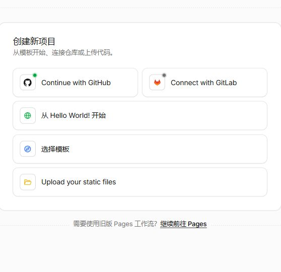
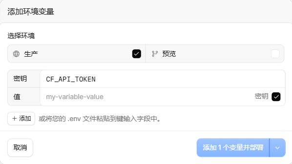
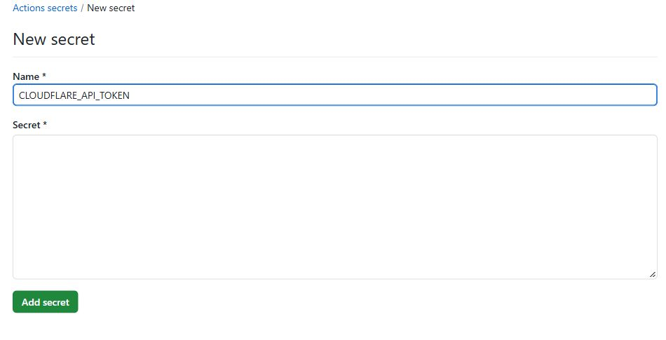
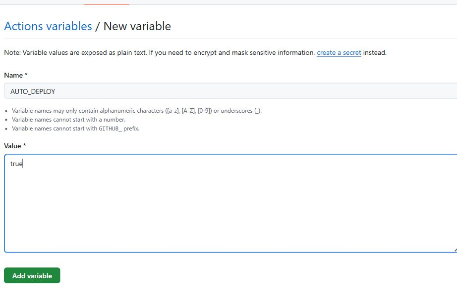

# 部署 ZoneSwitch 到 Cloudflare

[English](deployment.en.md) | 简体中文 · [返回项目介绍](../README.zh-CN.md)

选择一种操作方式：[一句话交给 AI 部署](#方式一一句话交给-ai-部署)，或按[手工详细部署步骤](#方式二手工详细部署步骤)自行配置。两种方式部署的是同一套项目，AI 需要具备代码执行或浏览器操作能力，以及你授权使用的 GitHub、Cloudflare 登录态或部署凭据。

## 方式一：一句话交给 AI 部署

把下面这句话发给你的 AI 编程助手：

> 请阅读 https://github.com/liaobin98/ZoneSwitch 的 README 和 docs/deployment.md，按本文将 release 分支部署到我的 Cloudflare 账号，使用我提供的后台域名和选定的自动部署平台，缺少的信息一次列出，凭据通过安全输入或平台 Secret 配置且不写入源码、日志或回复，完成后核对三个 Worker、HTTPS 登录与域名同步，未经单独授权不切换业务域名状态。

准备告诉 AI：自己的仓库地址、Cloudflare 账号、后台域名（例如 `control.example.com`），以及选择 **GitHub Actions** 还是 **Cloudflare Workers Builds**。后台密码由本人设置并生成哈希，Token 在平台 Secret 或工具的安全凭据入口填写，不发到聊天中。

AI 应按下面的手工步骤完成配置，并报告实际部署的提交、三个 Worker 的结果、后台访问和同步检查结果；仅完成构建或创建占位 Worker 不算部署完成。

## 方式二：手工详细部署步骤

### 1. 准备仓库、账号和域名

1. 将项目 Fork 到自己的 GitHub 账号。创建 Fork 时取消 **Copy the main branch only**，保留 `release` 分支；若 Fork 已存在，确认它包含 `release`。
2. 准备自己的 Cloudflare 账号和已激活的托管域，选定后台域名，例如 `control.example.com`。
3. 准备本地 **Node.js 24** 和 npm，用于生成后台密码哈希。自动构建平台负责安装依赖和部署，本地无需登录 Wrangler。
4. 同一套 Worker 选择一个自动部署平台：**GitHub Actions** 或 **Cloudflare Workers Builds**，不要同时启用两套部署触发器。

`main` 用于开发和本地检查；生产部署使用 `release`。GitHub Actions 只响应 `release` 推送，手动运行也要选择 `release`；`main` 推送和 PR 不触发工作流。Workers Builds 的生产分支同样设置为 `release`。

项目部署以下三个 Worker，默认名称可直接使用：

| Worker | 配置文件 | 用途 |
| --- | --- | --- |
| `zone-switch` | `wrangler.jsonc` | 管理后台、登录、API、Durable Object 状态与操作日志 |
| `zone-switch-maintenance` | `wrangler.maintenance.jsonc` | 静态维护提示页 |
| `zone-switch-billing` | `wrangler.billing.jsonc` | 静态欠费提示页 |

后台的 `STATE` 绑定和 SQLite 迁移由配置创建，无需另建 KV、D1 或 R2。两个提示 Worker 只提供静态资源，不配置后台凭据、DO 或业务 Custom Domain。正常业务流量直接访问原服务；后台通过临时 Worker Route 切换提示页，保留业务 DNS 和 Custom Domain。

待管理的服务器 A / AAAA / CNAME 记录需要开启 Cloudflare 代理；Worker 服务需要已经绑定业务 Custom Domain。仅 DNS 的入口可查看，不能切换到提示页。

### 2. 创建后台管理 Token 和部署身份

在 Cloudflare 的 **个人资料 → API 令牌 → 创建令牌 → 自定义令牌**中创建后台管理 Token，配置以下权限：

| 资源 | 权限 | 用途 |
| --- | --- | --- |
| Zone | Zone Read | 列出授权的域 |
| Zone | DNS Read | 读取 A / AAAA / CNAME 记录 |
| Zone | Workers Routes Edit / Write | 读取和修改临时 Routes |
| Account | Workers Scripts Read | 读取 Worker Custom Domains |

账号范围选择部署后台的账号，Zone 范围只包含需要管理的域。将这个 Token 保存为后台的 `CF_API_TOKEN`，不需要给它 DNS Edit、Workers Scripts Write 或 Global API Key 权限。

部署身份用于上传三个 Worker，与后台管理 Token 分开：

- **GitHub Actions**：使用 Cloudflare 的 **Edit Cloudflare Workers** 模板创建部署 Token，授权目标账号及所需资源，保存到自己 Fork 的 `CLOUDFLARE_API_TOKEN` Secret。
- **Workers Builds**：在各 Worker 的构建设置中选择具有部署权限的 API Token，可使用平台提供的创建流程，无需向 GitHub 添加 Cloudflare 部署凭据。

### 3. 创建后台并配置运行参数

在 Cloudflare **Workers 和 Pages → 创建应用程序**选择“**从 Hello World! 开始**”，创建名为 `zone-switch` 的占位 Worker。项目部署会替换占位代码。



将下面的 `YOUR_ACCOUNT` 替换为自己的 GitHub 账号（仓库改名时也替换仓库名），克隆 Fork 的 `release` 分支并生成密码哈希：

```sh
git clone --branch release https://github.com/YOUR_ACCOUNT/ZoneSwitch.git
cd ZoneSwitch
npm ci
npm run password
```

按提示输入自己设置的 8～32 位密码。保存密码用于登录，将输出的完整 `pbkdf2-sha256$...` 哈希填入下面的 `ADMIN_PASSWORD_HASH`，不要填明文密码。

进入后台 Worker 的 **设置 → 运行时变量和密钥**（也可能标为 **Variables & Secrets**），添加以下生产环境参数并部署使其生效：

| 类型 | 名称 | 值 |
| --- | --- | --- |
| Secret | `CF_ACCOUNT_ID` | 所选 Cloudflare 账号的 32 位 Account ID |
| Secret | `CONTROL_HOST` | 后台域名，例如 `control.example.com`，不含协议、端口或路径 |
| Text | `WORKER_NAME` | `zone-switch` |
| Text | `MAINTENANCE_WORKER_NAME` | `zone-switch-maintenance` |
| Text | `BILLING_WORKER_NAME` | `zone-switch-billing` |
| Secret | `ADMIN_USERNAME` | 自己设置的后台账号 |
| Secret | `ADMIN_PASSWORD_HASH` | 上一步生成的完整密码哈希 |
| Secret | `CF_API_TOKEN` | 第 2 步创建的后台管理 Token |

账号 ID、域名和用户名也使用 Secret 保存，避免在公共配置中暴露个人部署资料。Token 和密码哈希必须使用 Secret。三个 Worker 名称若也需要隐藏，可改用 Secret，但实际部署名称和后台参数必须一致。



在后台 Worker 的 **域 / Domains** 或 **设置 → Domains & Routes** 中添加 Custom Domain，使其与 `CONTROL_HOST` 完全一致。只保存变量不会自动绑定域名。


生产环境不设置 `DEMO_MODE`。公共配置关闭 `workers.dev` 和预览 URL，后台通过自己的 HTTPS Custom Domain 访问。不要把 Account ID、域名、账号、哈希、Token 或业务 Routes 填进仓库内的 Wrangler 配置。

### 4. 配置自动部署平台

选择下面的 A 或 B，完成后进入[第 5 步验收](#5-确认部署与功能)。

#### A. GitHub Actions

1. 在自己 Fork 的 **Actions** 页面启用工作流“**检查并部署 ZoneSwitch**”。
2. 打开 **Settings → Secrets and variables → Actions**，添加以下 **Repository secrets**：

| 名称 | 值 |
| --- | --- |
| `CLOUDFLARE_ACCOUNT_ID` | 部署账号的 Account ID，与后台 `CF_ACCOUNT_ID` 一致 |
| `CLOUDFLARE_API_TOKEN` | 第 2 步准备的部署 Token，不是后台管理 Token |



3. 在 **Variables** 中添加 **Repository variable**：`AUTO_DEPLOY`，值为小写 `true`。



4. 使用默认 Worker 名称时无需增加名称配置。自定义名称时，添加 `WORKER_NAME`、`MAINTENANCE_WORKER_NAME`、`BILLING_WORKER_NAME` 三个同名 Variables 或 Secrets，并同步后台运行参数；工作流优先读取 Secrets。
5. 打开 **Actions → 检查并部署 ZoneSwitch → Run workflow**，选择 `release`，首次保持 `target=auto`，运行工作流。

工作流执行测试、类型检查、前端构建和三个 Worker 的 dry-run，再按 **维护页 → 欠费页 → 后台**的顺序部署。两个提示 Worker 可由首次部署创建。

`auto` 对比各 Worker 的部署内容摘要，只上传变化项；没有成功记录时执行部署。静态 Worker 比较最终静态产物、配置、依赖锁文件和 Node 版本，后台还比较动态源码。共享模板、文案或依赖变化可能影响多个 Worker，不能保证只更新一个。

只改文档仍运行检查，部署内容不变时跳过上传。需要强制重部署时可选 `admin`、`maintenance`、`billing` 或 `all`；线上内容被外部改动后，可用 `all` 重新对齐。部署结果通过 GitHub 自动提供的 `GITHUB_TOKEN` 保存，不需要额外的 GitHub PAT；仓库需允许工作流的 `deployments: write` 权限。

确认“**类型检查和构建**”通过，并核对“**按变化部署 Worker**”中的各 Worker 结果。`AUTO_DEPLOY` 未设置为 `true` 时只检查、不部署；整个部署任务被跳过不代表代码已上传。

#### B. Cloudflare Workers Builds

GitHub 的 `AUTO_DEPLOY` 留空或设为 `false`。在 Cloudflare 准备三个同名 Worker，可用占位代码创建，然后分别在 **Settings → Build / Builds** 连接自己的 GitHub Fork：

1. 授权 Cloudflare 的 GitHub 集成访问自己的仓库。
2. 生产分支选择 `release`，根目录选择仓库根目录，Node.js 使用仓库 `.node-version` 指定的 **24**。
3. 关闭非生产分支的预览构建（**Enable Preview Builds**）。
4. 为每个 Worker 选择部署 API Token，填写对应命令：

| Worker | Build command | Deploy command |
| --- | --- | --- |
| `zone-switch-maintenance` | `npm run build:ci` | `npm run deploy:maintenance` |
| `zone-switch-billing` | `npm run build:ci` | `npm run deploy:billing` |
| `zone-switch` | `npm run build:ci` | `npm run deploy:ci` |

构建系统安装依赖后运行构建命令。后台凭据填在第 3 步的运行时 Secrets，不填 Build variables；GitHub Variables 也不会自动传到 Workers Builds。

使用自定义名称时，在每个 Worker 的构建变量中分别设置 `WORKER_NAME` 为该 Worker 的实际名称，将 Deploy command 改为 `npx wrangler deploy --config <对应配置文件> --name "$WORKER_NAME"`；把占位的配置文件替换为本页表格中的真实文件名。后台运行时的三个名称也要与实际部署一致。

在各 Worker 的 **Build watch paths** 中设置 Include paths，每行添加一条，Exclude paths 留空。三套都包含：

```text
package.json
package-lock.json
.node-version
vite.config.ts
tsconfig*.json
ui/notice/*
shared/notice-*
shared/contracts.ts
src/maintenance.ts
src/notice-icons.ts
src/utils.ts
scripts/static-notices.mjs
```

再按 Worker 追加：

| Worker | 额外 Include paths |
| --- | --- |
| 后台 | `wrangler.jsonc`、`src/*`、`shared/*`、`ui/admin/*`、`public/*`、`index.html` |
| 维护页 | `wrangler.maintenance.jsonc` |
| 欠费页 | `wrangler.billing.jsonc` |

路径匹配规则见 [Cloudflare Build watch paths](https://developers.cloudflare.com/workers/ci-cd/builds/build-watch-paths/)。监听路径决定是否构建，不进行产物摘要比较；共享文件修改可能触发多套，只改文档不命中这些路径。首次连接、手动构建或重试仍可能运行构建。

三个构建独立执行，不保证顺序。先确认维护页和欠费页部署成功，再确认后台，三套就绪后才操作业务域名。每次检查各自构建记录中的提交和部署结果。

### 5. 确认部署与功能

1. 核对三个 Worker 的实际名称、部署提交和成功结果，等待后台域名与 HTTPS 证书就绪。
2. 用自己设置的账号和密码登录，检查后台简体中文 / 英文切换。
3. 点击“**同步域名**”，确认授权域及 Worker、服务器代理入口完整显示；同步成功与否以列表中的具体结果为准。
4. 选择获准操作的非关键业务域名，验证维护、欠费和恢复。检查临时 `<hostname>/*` Route 的目标，以及原业务 DNS 和 Custom Domain 未被更改；恢复通配维护下的具体主机可能添加精确无脚本 Route 作为例外。
5. 访问业务域首页与深层路径。提示页对 GET / HEAD 返回 HTTP 200 HTML，不支持的方法返回 405；欠费状态由管理员手动设置，不检测账单或收款。
6. 已确认的当前状态对应按钮不可点击，批量会跳过已处于目标状态的域名。单个确认后关闭弹窗并通过顶部消息反馈；批量显示进度，全部成功且列表更新后自动关闭，异常或“待核实”时保留窗口，随后同步核实并查看操作记录。

真实访客页在首次绘制前按浏览器的语言偏好顺序选择：所有 `zh` 语言标识显示繁体中文，`ja` 显示日文，`en` 显示英文，其余偏好继续匹配，均不支持时回退英文。手动切换后刷新会重新选择。页面不请求地区定位，两个提示 Worker 的静态服务不执行动态 Worker。

后台预览可指定语言；默认“按访问地区”使用管理员请求的 Cloudflare 地区选择文案，台湾、香港、澳门为繁体中文，日本为日文，其他地区为英文。它由后台 API 提供，不能替代真实访客页验收。

### 6. 日常更新与配置管理

- **获取代码更新**：在自己的 Fork 切换到 `release`，使用 **Sync fork → Update branch**，或将已验收的开发修改合入 `release`；所选平台按上述规则构建与部署。同步上游需要自行操作，不会定时强制同步。
- **保留运行数据**：公共配置保留后台面板变量与 Secrets，不声明业务 Routes；保持原账号、Worker 名称、`STATE` 绑定、`ZoneSwitchState` 类名和 migrations 历史，更新代码不清空 DO。
- **修改后台账号或密码**：在 Cloudflare 更新 `ADMIN_USERNAME`，或重新生成哈希并更新 `ADMIN_PASSWORD_HASH`，部署后生效，已有会话失效。后台没有修改这些参数的设置页。
- **更换 Token**：管理 Token 更新后台的 `CF_API_TOKEN` Secret；部署 Token 更新所选部署平台的配置。
- **处理部分失败**：成功项不会因其他项失败而自动回滚，修复失败项后重试并核对所有结果；域名操作结果不明确时同步查询，不删除 DO 或路由归属记录。

## 使用自己的账号本地开发

将 `.dev.vars.example` 复制为 `.dev.vars`，填写自己的参数，设置 `CONTROL_HOST="127.0.0.1"`，不设置 `DEMO_MODE`，运行 `npm run dev` 后访问 `http://127.0.0.1:8787`。此模式会调用真实 Cloudflare API，切换操作会修改真实路由；只体验界面请按 [README 的本地演示](../README.zh-CN.md#本地演示)操作。

`.dev.vars`、个人配置、本地状态、日志和构建产物不提交到仓库；文档截图只使用示例或已排除个人信息的配置区域。

## 故障排查

| 现象 | 检查项 |
| --- | --- |
| Actions 没有运行 | Fork 已启用 Actions，推送或手动选择的分支为 `release`；`main` 和 PR 不触发 |
| Actions 检查通过但没有部署 | `AUTO_DEPLOY=true`；区分整个任务被跳过与单个 Worker 内容未变化 |
| Workers Builds 没触发 | GitHub 集成授权、生产分支、监听路径及对应 Worker 的构建记录 |
| 部署 401 / 403 | 部署 Token 的权限、有效期和账号；不能用后台只读脚本权限的管理 Token 代替 |
| 后台 404 或无法登录 | HTTPS Custom Domain、`CONTROL_HOST`、完整密码哈希、运行参数已部署；登录限流需等待 |
| 登录正常但同步失败 | 后台 `CF_API_TOKEN` 的四项权限、账号和 Zone 范围，以及列表中的具体错误 |
| 提示页语言与浏览器界面不一致 | 浏览器的首选网页语言顺序，`en-US, zh-CN` 优先英文，`zh-CN, en-US` 显示繁体中文 |
| 开启后仍显示原页面 | 实际业务 Route 的目标、Cloudflare 配置传播、浏览器及 Service Worker 缓存 |
| 路由冲突或“待核实” | 检查实际 Routes 与归属，处理冲突后同步；不要覆盖其他系统的路由 |

## 参考

- [项目工作流](../.github/workflows/deploy.yml) · [部署脚本](../scripts/deploy.mjs)
- [Cloudflare：GitHub Actions 部署](https://developers.cloudflare.com/workers/ci-cd/external-cicd/github-actions/)
- [Cloudflare：Workers Builds 配置](https://developers.cloudflare.com/workers/ci-cd/builds/configuration/)
- [Cloudflare：Secrets](https://developers.cloudflare.com/workers/configuration/secrets/)
